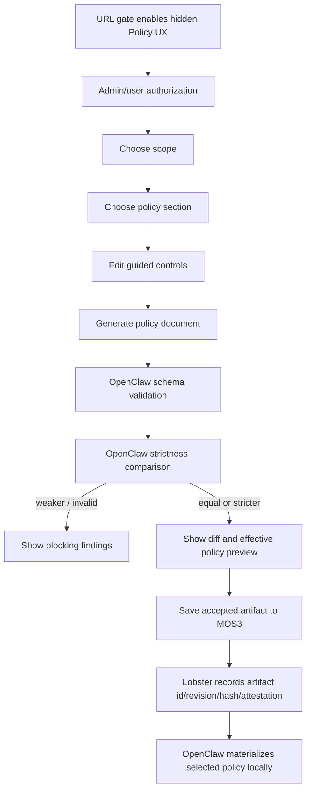

# Policy UX Proposal

Status: draft for Jesse review

Last updated: 2026-06-19

## Goal

Expose OpenClaw policy authoring in Lobster without turning it on by default.
The first UX should be an operator/demo surface for shaping the model, proving
section coverage, and validating the save/preview flow before it becomes a
normal tenant or user-facing setting.

## Activation Gate

The policy UX is hidden by default.

Initial access should require an explicit URL gate:

```text
/admin/policy?enablePolicyUx=1
```

Behavior:

- Without the gate, no policy editor entry point appears in navigation.
- With the gate, the policy editor appears for authorized users only.
- The gate enables UI access only; server-side policy writes still require the
  normal admin authorization and validation path.
- The gate should be easy to remove once the UX shape is approved.

Optional later gates:

- tenant feature flag for internal dogfood tenants
- app config flag for deployment-wide enablement
- per-user allowlist for product/design review sessions

## User Story

As a tenant admin or policy owner, I want to create or edit a policy through a
guided UX, scoped to the right tenant, user, agent, or channel, and save it only
if it is valid and at least as strict as the inherited baseline.

As a personal user, I want to create a personal policy that narrows my own
OpenClaw behavior without weakening tenant or deployment requirements.

## Product Shape

The UX should not be a raw JSON editor first. It should be a section-aware
builder with an escape hatch to inspect generated policy.

Primary views:

1. Policy summary
2. Section editor
3. Scope editor
4. Preview and compare
5. Save to MOS3

## Section Model

The UX should be driven by a descriptor registry that maps policy paths to
section metadata. This avoids hardcoding every control into one page.

Suggested sections:

| Section           | Example coverage                                                           |
| ----------------- | -------------------------------------------------------------------------- |
| Tools             | tool allow/deny, elevated defaults, safe-bin trusted dirs, agent-to-agent  |
| Sandbox           | allowed modes, default posture, escalation behavior                        |
| Model and network | model/provider restrictions, network posture, remote access                |
| Gateway           | gateway access, proxy behavior, runtime gates                              |
| Channels          | ingress/egress channel rules, channel-specific controls                    |
| Data and auth     | credential handling, storage, identity, data movement                      |
| Exec approvals    | approval evidence, scope, missing/invalid artifact behavior                |
| Plugins and feeds | plugin allow/deny, tenant feed requirements, public-feed bypass prevention |

Descriptor fields:

```text
policyPath
label
description
section
valueKind
validScopes
strictnessDirection
defaultDisplay
validationHints
```

## Scope Model

The UX needs first-class scope selection because policy is not just one flat
document.

Suggested scopes:

| Scope             | Purpose                                                     |
| ----------------- | ----------------------------------------------------------- |
| Deployment/global | minimum floor for all tenants                               |
| Tenant            | tenant-selected override, equal-or-stricter than deployment |
| User personal     | personal override, equal-or-stricter than tenant effective  |
| Agent             | agent-specific narrowing                                    |
| Channel           | channel-specific narrowing                                  |
| Workspace/session | local or temporary overlay, if supported by the spec        |

The editor should only show controls valid for the selected section and scope.
For example, channel controls should not appear in a pure tool posture editor
unless the policy path supports channel-scoped overrides.

## UX Flow



## Preview Requirements

Before save, the UX should show:

- policy validity
- inherited baseline source
- strictness result: equal, stricter, weaker, incompatible, unknown
- changed policy paths
- affected sections
- affected scopes
- blocked save reasons
- generated JSON preview
- MOS3 artifact metadata that will be recorded after save

The preview should use the same language as the policy doctor where possible:
findings, evidence, conformance, strictness, baseline, effective policy.

## Save Requirements

Saving a policy requires:

- valid OpenClaw policy document
- supported spec keys only
- OpenClaw comparison result of equal or stricter
- MOS3 artifact id/revision/hash
- hash match between artifact metadata and materialized policy content
- Lobster state record for the selected scope
- audit metadata for who saved it and what baseline it was compared against

For personal policy, this maps to Lobster #3388:

- personal policy must be MOS3-backed
- personal policy must compare equal-or-stricter than the tenant-effective
  baseline
- user bootstrap selects personal override first, then tenant override, then
  deployment default

## Non-Goals For First UX

- no default public navigation entry
- no broad tenant rollout
- no unsupported policy keys
- no weakening tenant or deployment policy
- no enforcement bypass for URL-gated users
- no hand-authored raw JSON as the primary experience

## First Implementation Slice

Suggested PR sequence:

1. Add hidden policy UX route behind `?enablePolicyUx=1`.
2. Add descriptor registry for sections, policy paths, value kinds, and valid
   scopes.
3. Add read-only policy summary and generated JSON preview.
4. Add compare-only flow using OpenClaw validation/strictness output.
5. Add save flow for personal policies using the #3388 acceptance path.

The first demo does not need every control implemented, but it should prove the
architecture can cover every section and every scope without redesign.

## Open Questions

- Should the URL gate be query-string only, or query string plus tenant/app
  feature flag?
- Should personal policy authoring be available to all users or only tenant
  admins during preview?
- Which sections are safe to expose first for Jesse review?
- Should raw JSON editing be hidden behind an advanced mode, or kept read-only
  until the guided controls mature?
- Do plugin/feed controls wait for RFC #19 implementation, or appear as a
  disabled/preview-only section?
