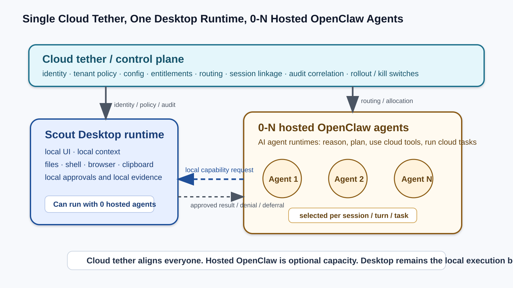
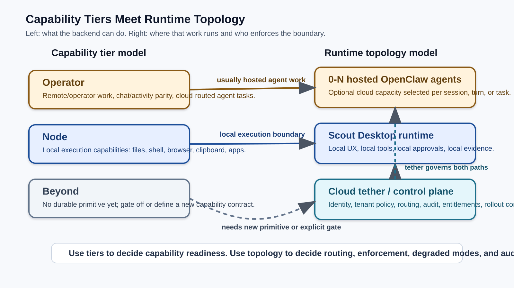
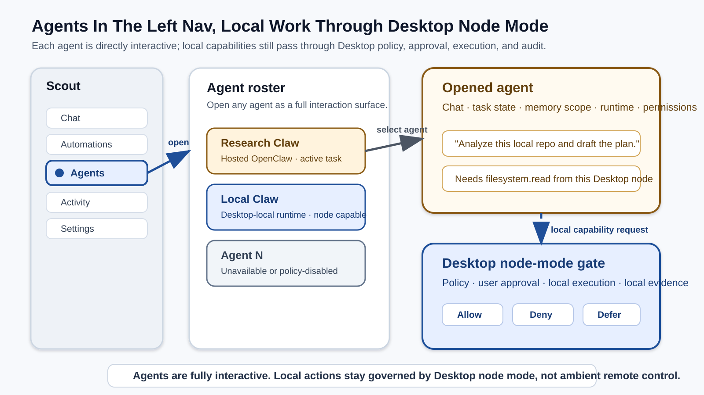
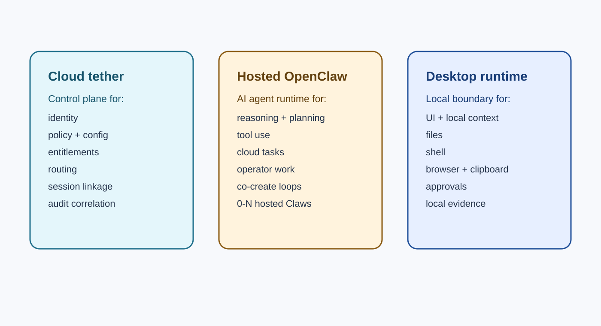
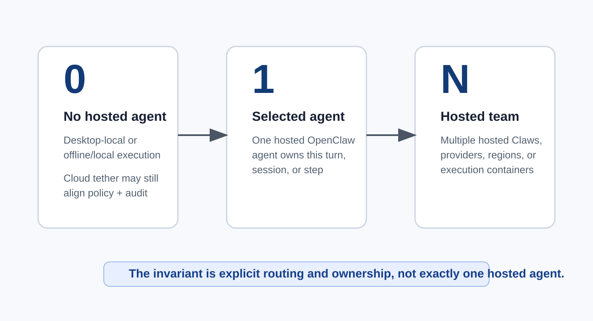
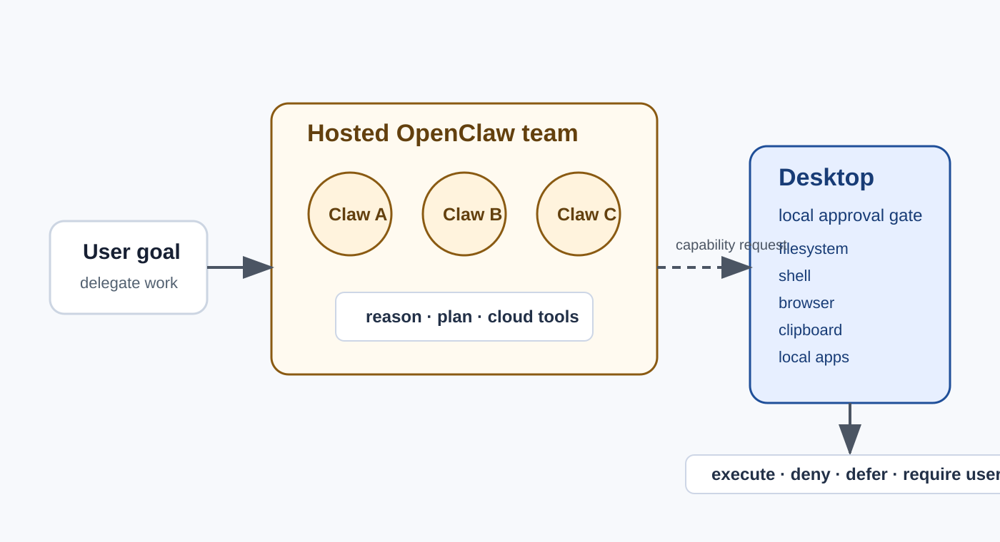
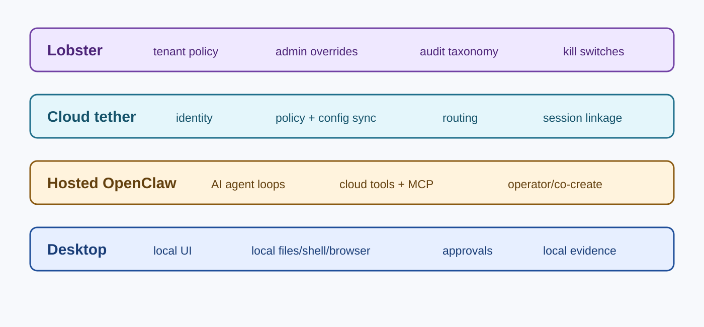
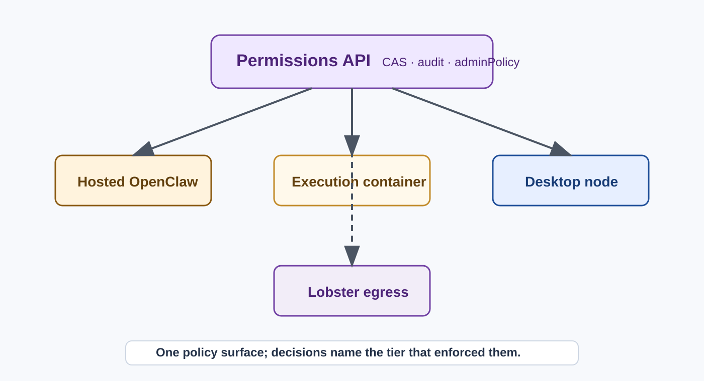
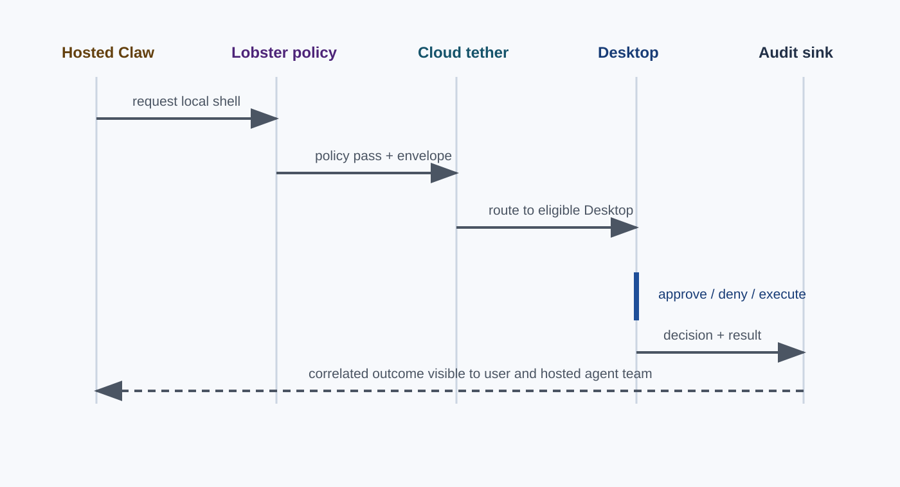

# Scout Desktop, Cloud Tether, and Hosted OpenClaw

One cloud tether/control plane. One Scout Desktop runtime. Zero, one, or many hosted OpenClaw agents available through routing.

June 25, 2026

---

## The Core Picture

---

## Tier To Topology Alignment

---

## Agents As A First-Class Surface

---

## Definitions

---

## Runtime Cardinality

---

## Team Of Claws, Local Desktop Gate

---

## Scope Boundaries

---

## Permission Fanout

---

## Local Capability Request

---

## Decisions Needed

| Question                                                                                       | Why it matters                                                          |
| ---------------------------------------------------------------------------------------------- | ----------------------------------------------------------------------- |
| Is Cloud tether separate from hosted OpenClaw capacity?                                        | Lets Desktop stay managed even when hosted agents are unavailable.      |
| Can Desktop operate with 0, 1, or N hosted OpenClaw agents?                                    | Avoids assuming exactly one server-side agent.                          |
| Is Desktop a first-class enforcement layer?                                                    | Local files, shell, browser, clipboard, and apps need Desktop approval. |
| What fields identify `agentMemberId`, `agentBinding`, `executionTier`, and `cloudTetherState`? | Required for routing, audit, evals, and user-visible explanations.      |
| Which degraded modes fail closed, defer, retry, or reroute?                                    | Prevents ambiguous behavior during capacity, reset, or offline cases.   |
