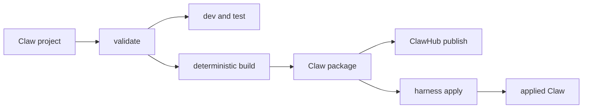

# Claws End-to-End Application Framework Design

Status: design candidate for Patrick/Peter review; not yet an RFC contract.

## Thesis

OpenClaw already owns the runtime primitives needed by a complete agent:
agents, models, tools, sandboxes, plugins, MCP servers, channels, secrets,
schedules, workspaces, bootstrap, status, and diagnostics. The missing product
is one Claw project and developer lifecycle that composes those owners into a
reproducible application.

The proposed framing is:

```text
OpenClaw   runtime and canonical capability owners
Claws     application project, build artifact, and development lifecycle
ClawHub   publication, discovery, scanning, and immutable distribution
```

A Claw should become the standard way to build, test, package, distribute, and
apply an OpenClaw application. It should not become a second Gateway, channel
installer, secret store, plugin manager, or config writer.

This thesis is falsified if the first vertical slice must duplicate OpenClaw
mutation logic, introduce schema version 2, store onboarding answers, execute
portable package scripts, or place secrets in the package. It is also falsified
if a generated project cannot be built and exercised without manually editing
the generated artifact.

## Product Model

Three states must be named separately:

1. **Claw project:** human-authored source, profiles, tests, fixtures, and local
   development metadata.
2. **Claw package:** deterministic immutable artifact containing portable
   `CLAW.md`, package content, and conventional harness profiles.
3. **Applied Claw:** one agent realized by a harness, plus host-owned local
   configuration and provenance.



The package is not a whole OpenClaw instance export. The applied instance is
not portable because credentials, selected accounts, channel addresses, host
paths, runtime availability, and operator policy remain local.

## Source Audit

The audit used current OpenClaw `upstream/main` at
`8a4da1d19fadb839d59bd581e8b2403460c873c9` plus the schema-v1 Claws stack at
OpenClaw PRs #115237 and #115962.

### Existing owners

| Concern                          | Current owner and evidence                                                                                     | Reuse decision                                                                                               |
| -------------------------------- | -------------------------------------------------------------------------------------------------------------- | ------------------------------------------------------------------------------------------------------------ |
| Agent identity and configuration | `src/config/types.agents.ts` defines per-agent model, memory, tools, sandbox, heartbeat, runtime, and identity | Reuse agent creation and config validation                                                                   |
| Model selection                  | `AgentConfig.model`, model catalogs, model-policy validation, and provider auth commands                       | Profile may select a model; model availability and credentials remain owner-validated                        |
| Tool posture                     | `AgentToolsConfig`, registered tool profiles, allow/deny policy, and capability consent                        | Reuse; already supported by `profiles/openclaw.yml`                                                          |
| Sandbox                          | `AgentSandboxConfig` and sandbox backend owners                                                                | Reuse a safe per-agent subset; never package host paths, keys, binds, setup commands, or dangerous overrides |
| Plugins and native extensions    | Canonical plugin preflight/install/update/uninstall and bundle inspection                                      | Reuse; already delegated by profile extensions                                                               |
| Skills                           | Existing skill package and discovery owners                                                                    | Reuse portable exact package declarations                                                                    |
| MCP                              | Existing MCP normalization, OAuth, environment prerequisites, and Claw lifecycle                               | Reuse direct portable declarations and owner readiness                                                       |
| Workspace and assets             | Claw managed-file planner, digests, provenance, update, and removal                                            | Reuse ordinary files and directory conventions                                                               |
| Onboarding                       | Native package-root `BOOTSTRAP.md` seed-once lifecycle                                                         | Reuse; no forms or answer database                                                                           |
| Schedules                        | OpenClaw cron owner and existing Claw `cronJobs`                                                               | Reuse portable schedules and local enablement/readiness                                                      |
| Channels                         | Channel-specific account setup plus canonical agent routing bindings                                           | Add requirements and owner handoff; do not package accounts, tokens, peer ids, or credentials                |
| Secrets and connections          | `SecretInput`/SecretRef owners, plugin setup, MCP OAuth, and channel setup                                     | Package only prerequisites; resolve locally through canonical setup surfaces                                 |
| Rich UI                          | Agent tools such as `show_widget`, packaged assets, and Control UI                                             | Keep as profile/tool behavior with complete message or Markdown fallback                                     |
| Status and repair                | Claw status/doctor plus capability-owner diagnostics                                                           | Reuse and aggregate; do not create project-specific runtime health state                                     |

### Existing OpenClaw profile

The experimental schema-v1 profile already supports:

- group-chat mention behavior;
- sandbox mode, scope, and workspace access;
- dynamic built-in tool profiles, allow/alsoAllow/deny, and workspace-only file
  posture;
- memory search and cross-conversation memory;
- heartbeat timing and active hours;
- human response delay; and
- exact native extension dependencies with detected component inventory.

This is already an application realization profile, not merely a plugin list.
The follow-on should extend this allowlisted, consented pattern for missing
OpenClaw application concerns. It should not embed arbitrary `openclaw.json`.

## Eve Comparison

Vercel describes Eve as a framework that builds an agent from files under
`agent/` and runs it as a durable service. Current first-party documentation
defines filesystem-owned instructions, model/runtime configuration, typed
tools, skills, channels, connections, extensions, one sandbox, subagents,
schedules, and evals.

Primary references:

- <https://vercel.com/eve>
- <https://eve.dev/docs/introduction>
- <https://eve.dev/docs/project-structure>
- <https://eve.dev/docs/agent-config>
- <https://eve.dev/docs/tools>
- <https://eve.dev/docs/sandbox>
- <https://eve.dev/docs/schedules>
- <https://eve.dev/docs/subagents>
- <https://eve.dev/docs/extensions>

### Adopt

- One obvious project directory.
- Filesystem conventions with progressive disclosure.
- A minimal project that works before optional capabilities are added.
- One coherent create, local-development, test, build, and publish path.
- Project-level evals that do not have to become runtime package fields.
- Native extension packages for executable harness behavior.

### Adapt

- Eve owns a TypeScript framework and Vercel runtime. Claws must delegate to
  the installed harness and canonical OpenClaw owners.
- Eve puts model and runtime code in `agent.ts`. Claws should put OpenClaw-only
  realization in `profiles/openclaw.yml`, with no portable claim.
- Eve channel files can contain executable adapters. A Claw should declare the
  needed channel and route intent, then hand account selection and credentials
  to OpenClaw channel owners.
- Eve tools execute application TypeScript. Claw-native executable behavior
  should remain in OpenClaw plugins/extensions; portable Claw content remains
  reviewable and non-executable.

### Avoid

- Making the source project and published artifact the same conceptual object.
- Reimplementing durable execution, channel delivery, sandboxing, or secrets in
  the Claws CLI.
- Treating arbitrary code as portable across harnesses.
- Requiring a Vercel-style deployment backend for local OpenClaw users.

## Capability Ownership Matrix

The matrix uses four declaration modes:

- **managed:** exact package-owned value reconciled through Claw lifecycle;
- **required:** application prerequisite that must be satisfied locally;
- **suggested:** author default the operator may replace before apply;
- **local:** never distributed as package state.

These modes describe policy for the follow-on design. They are not proposed as
four new generic schema wrappers. Each owner should expose the smallest native
shape that needs them.

| Capability           | Project/package declaration                                        | OpenClaw realization                        | Local/operator state                                     | Update/remove                                                          |
| -------------------- | ------------------------------------------------------------------ | ------------------------------------------- | -------------------------------------------------------- | ---------------------------------------------------------------------- |
| Purpose and identity | Managed `CLAW.md`                                                  | Agent identity and `SOUL.md`                | Optional local identity edits become drift/user choice   | Existing managed-file rules                                            |
| Skills and assets    | Managed exact packages/files                                       | Canonical skill owner and workspace planner | User-created outputs stay local                          | Existing provenance and safe removal                                   |
| Plugins              | Managed exact profile extensions                                   | Canonical plugin owners                     | Credentials and plugin-local choices                     | Dependency edges, owner update, optional cleanup                       |
| MCP                  | Managed endpoint/process declaration plus required auth/env        | Canonical MCP owner                         | OAuth grants, env values, SecretRefs                     | Existing status/update/remove                                          |
| Model                | Suggested or required exact OpenClaw model reference               | Model catalog and agent config owner        | Credentials and explicit operator override               | Record selected local override; never write provider secrets           |
| Tool policy          | Managed allowlisted profile/allow/deny posture                     | Existing agent tool policy                  | Host policy may further restrict, never broaden silently | Existing capability consent and drift                                  |
| Sandbox              | Managed safe posture plus optional required backend capability     | Existing sandbox owner                      | Installed backend, host paths, keys, network policy      | Diagnose unavailable backend; never package dangerous overrides        |
| Memory and heartbeat | Managed per-agent settings                                         | Existing owners                             | Host may block unsupported settings                      | Existing capability drift/update                                       |
| Channels             | Required channel kinds and route purpose, not account ids          | Channel setup and routing-binding owners    | Account, credential, guild/team/peer, and final binding  | Preserve local binding choice; warn before releasing Claw-created edge |
| Schedules            | Managed job definition                                             | Existing cron owner                         | Enablement, timezone override where explicitly allowed   | Existing cron lifecycle                                                |
| Onboarding           | Managed package-root bootstrap seed                                | Native bootstrap owner                      | Answers and generated user files                         | Never recreate consumed bootstrap                                      |
| UI experience        | Managed assets and instructions; required/suggested OpenClaw tools | Tool profile and `show_widget`              | Active client and placement availability                 | Message/Markdown fallback remains complete                             |
| Deployment           | Project test target only in V1                                     | Existing OpenClaw installation/Gateway      | Host topology, ports, auth, service manager              | Outside package lifecycle                                              |
| Evals                | Project-only scenarios                                             | OpenClaw CLI invokes the native lifecycle   | Model credentials and optional live budget               | Not shipped as runtime state by default                                |

## Proposed Project Shape

V1 should require no new root configuration file. `CLAW.md` and `package.json`
identify the project; optional directories add capabilities.

```text
my-claw/
├── package.json
├── CLAW.md
├── BOOTSTRAP.md                 # optional first-run instructions
├── profiles/
│   └── openclaw.yml             # OpenClaw realization
├── skills/                      # optional packaged skills
├── references/                  # ordinary managed assets
├── schemas/
├── templates/
├── examples/
├── fixtures/
└── tests/
    └── smoke.claw-test.yml      # project-only conformance scenario
```

`tests/` is project authoring content and is excluded from the runtime package
unless explicitly declared as an application fixture. The first slice should
use a small declarative scenario format; arbitrary test code can remain an
ordinary repository test outside the Claw toolchain.

A later project-only development file may map local plugin workspaces to exact
published extension identities. It should be introduced only after a custom
tool/extension vertical slice proves the need.

## Developer Lifecycle

```text
openclaw claws create
openclaw claws validate
openclaw claws dev
openclaw claws test
openclaw claws build
openclaw claws publish
openclaw claws apply <source>
```

This native OpenClaw surface is the V1 product. A standalone `npx claws`
toolchain may later expose the same project contract and call public harness
commands through `--agent openclaw`, but OpenClaw's application lifecycle must
not depend on that repository, npm name, or cross-harness adoption.

### Create

- Scaffold one understandable, immediately valid project.
- Offer a minimal default and a small number of purposeful examples, not a
  large template taxonomy.
- Generate readable Markdown/YAML without hidden code generation state.

### Validate

- Validate project conventions and the exact package/profile contracts.
- Resolve references without mutation.
- Report unsupported required capabilities before build.

### Dev

- Build a development snapshot.
- Use a disposable `OPENCLAW_STATE_DIR`, workspace, and agent id by default.
- Reuse native inspect, dry-run, consent, apply, status, and remove owners.
- Never mutate the operator's production OpenClaw instance implicitly.
- Print the exact native chat/Control UI entry point and clean up disposable
  state on explicit stop/remove.

### Test

- Always run static package and lifecycle conformance.
- Run deterministic fixture scenarios without provider access by default.
- Require `--live` plus explicit provider/model budget for model evaluations.
- Assert application outputs, packaged assets, capability readiness, and rich
  UI fallback behavior without snapshotting private user content.

### Build

- Produce a deterministic artifact from validated project inputs.
- Exclude project-only tests, caches, local credentials, local paths, and
  unselected user content.
- Re-read the built artifact through the reference parser.
- Prove byte-identical output for unchanged inputs.
- Do not execute package-authored build hooks in V1.

### Publish and Add

- Publish the exact built artifact to experimental ClawHub with digest,
  scanning, metadata, and version immutability.
- Resolve that exact artifact for add.
- Delegate every OpenClaw mutation and local setup step to canonical owners.

## OpenClaw Profile Follow-On

The first profile expansion should be bounded to concerns that materially make
one agent runnable:

1. exact suggested/required agent model selection with catalog validation;
2. safe sandbox backend requirements and browser availability, excluding host
   paths, credentials, binds, setup commands, and dangerous overrides;
3. channel-kind prerequisites and a canonical owner handoff for account setup
   and agent routing; and
4. explicit readiness for unavailable tools/UI capabilities while preserving
   complete fallback output.

The profile must remain strict and allowlisted. It must not accept arbitrary
OpenClaw config paths or top-level config patches.

Subagents, arbitrary runtime selection, provider definitions, channel account
configuration, Gateway deployment, and sandbox setup code remain follow-ups.

## Role Review Findings

### Founder and new-hire

- **Keep:** a folder with Markdown/YAML remains understandable without the CLI.
- **Blocker avoided:** no required TypeScript framework, generated lock-in, or
  second setup language.
- **Revision:** the first-run command surface should emphasize four author
  actions: create, dev, test, build. Publish/add appear when needed.

### Gateway engineer

- **Keep:** all project parsing, building, and validation occurs before runtime;
  no per-turn Claw parser or framework hook is added.
- **Blocker avoided:** `dev` invokes canonical CLI/Gateway surfaces rather than
  importing private runtime modules.
- **Required proof:** disposable dev start/stop must leave no production config,
  process, workspace, or state record behind.

### Platform operator and power user

- **Keep:** deterministic artifacts, status, doctor, update, and remove are more
  valuable than scaffold volume.
- **Revision:** dev defaults to isolation, while production apply remains an
  explicit separate action against a named OpenClaw instance.
- **Required proof:** clean-machine apply and update from an immutable ClawHub
  artifact, including partial local-prerequisite failure.

### CISO

- **Keep:** capability preview and exact plan-integrity consent cover model,
  sandbox, channel, plugin, MCP, schedule, and UI effects.
- **Blocker avoided:** no tokens, account ids, peer ids, host paths, sandbox
  keys, or provider definitions enter the package.
- **Revision:** channel declarations are prerequisites plus canonical setup
  handoffs, not distributable channel configuration.

### Skill author and repository steward

- **Keep:** skills stay ordinary Agent Skills and executable OpenClaw behavior
  stays in plugins/extensions.
- **Blocker avoided:** project commands reuse native lifecycle modules and do
  not become another mutation owner.
- **Required proof:** the packed OpenClaw CLI exercises the project lifecycle
  on Linux, macOS, Windows, and WSL without private cross-package coupling.

### Release engineer

- **Keep:** build and publish are separate; publication accepts only the exact
  already-tested artifact.
- **Required proof:** fresh-prefix packed CLI smoke, deterministic rebuild, exact
  ClawHub digest, and clean-recipient add.

## V1 Boundaries

- OpenClaw is the V1 product, command surface, and runtime.
- Portable package schema remains version 1.
- No arbitrary portable code, package scripts, or build hooks.
- No structured setup forms or persisted answer store.
- No package-defined secrets, provider credentials, channel accounts, or host
  paths.
- No Gateway deployment abstraction.
- No multi-agent/subagent package model.
- No promise that Eve, Hermes, Codex, or Claude realizes every component.
- No generic capability vocabulary until a second adapter demonstrates a real
  shared semantic need.

## Smallest Evidence Slice

Use one copyable reference project with:

- a `CLAW.md` body and identity;
- one packaged schema and one output template;
- one exact existing OpenClaw extension;
- direct MCP with a local credential prerequisite;
- safe tool and sandbox posture;
- `BOOTSTRAP.md` that writes user-owned preferences;
- one schedule disabled or isolated for deterministic proof;
- one `show_widget` path with a complete Markdown fallback; and
- one static scenario plus one optional live scenario.

Prove:

```text
create -> validate -> isolated dev apply -> static test -> deterministic build
       -> exact artifact inspect -> clean OpenClaw add -> status/doctor -> remove
```

Accepted result: the app is ready except for an explicitly reported local MCP
credential, renders the fixture through the requested rich UI when available,
returns equivalent Markdown otherwise, and removes all unchanged managed state
while preserving bootstrap-created user content.

Structured failure: an unavailable required model, sandbox backend, channel, or
extension blocks the complete plan before mutation and identifies the canonical
owner setup path.

Deletion target: hand-written test scripts, post-export package edits, manual
temporary OpenClaw state setup, and separate package-vs-runtime validation steps
for this reference application.

## Decision Checkpoint

Before authoring the follow-on RFC 0016 addendum or adding profile fields,
confirm with Patrick and Peter:

1. Claws is intended to be OpenClaw's application framework, not only a package
   installer.
2. The project/package/applied distinction is the right mental model.
3. Exact model and channel requirements belong in the OpenClaw realization
   profile while credentials and concrete bindings remain local.
4. The first milestone is native OpenClaw create/dev/test/build/publish/apply;
   a standalone CLI and foreign adapters may consume the contract later but do
   not drive V1 abstractions.
