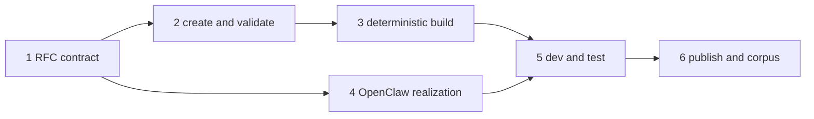

# Claws End-to-End Application Framework PR Plan

Status: proposed follow-on to the schema-v1 package/lifecycle stack. Do not
modify or block the current stack until the design checkpoint is accepted.

## Sequence

### PR 1: RFC 0016 application framework addendum - `openclaw/rfcs`

- Update `rfcs/0016-claws.md`; do not allocate a new RFC number.
- Add `rfcs/0016/claw-project-v1-spec.md` parallel to the existing CLAW,
  package, and OpenClaw-profile V1 specs.
- Add or update `rfcs/0016/implementation-plan.md`; do not create another
  numbered RFC directory for this addendum.
- Position Claws as OpenClaw's application framework and ClawHub as its
  distribution service.
- Define Claw project, built package, and applied Claw.
- Normatively define authoring/build boundaries and owner delegation.
- Add the bounded OpenClaw profile follow-on: model selection, safe sandbox
  requirements, channel prerequisites/handoff, and UI readiness/fallback.
- Keep package schema version 1 and all current bootstrap/lifecycle decisions.

Exit proof: the new project sidecar and updated implementation plan pass role
review with no unresolved ownership contradiction.

### PR 2: Project create and validate - `openclaw/openclaw`

- Add `claws create` with one minimal template and one application example.
- Detect a project from `CLAW.md` plus `package.json`; add no root config file.
- Validate project-only directories and package exclusions.
- Preserve existing inspect, ClawHub resolution, and native lifecycle behavior.

Exit proof: a fresh directory becomes a readable valid project in one command;
editing one declared asset changes validation/integrity predictably.

### PR 3: Deterministic build - `openclaw/openclaw`

- Add `claws build` producing one immutable package artifact.
- Exclude tests, caches, credentials, host paths, and development metadata.
- Re-read the artifact and prove byte-identical rebuilds.
- Add packed-CLI clean-prefix proof.

Exit proof: two clean builds are byte-identical and the artifact independently
re-reads through the canonical OpenClaw package parser.

### PR 4: OpenClaw application realization - `openclaw/openclaw`

- Extend strict `profiles/openclaw.yml` with the accepted bounded fields.
- Delegate model, sandbox, channel, and UI readiness to canonical owners.
- Include every effect in inspect/dry-run, consent, provenance, status, doctor,
  update, export, and remove as appropriate.
- Never store credentials or automatically broaden host policy.

Exit proof: one package plans complete owner-attributed effects; unavailable
required capability blocks before mutation; local secrets never enter outputs.

### PR 5: Isolated dev and test lifecycle - `openclaw/openclaw`

- Add `openclaw claws dev` using disposable state by default.
- Add static `claws test`; gate provider-backed evaluations behind `--live`.
- Reuse native apply/status/doctor/remove lifecycle owners.
- Surface native chat/Control UI entry points without owning a Gateway API.

Exit proof: interruption and normal stop both clean disposable state; static
tests run offline; optional live tests report exact model and budget context.

### PR 6: Experimental publish and corpus - `openclaw/clawhub` plus
`openclaw/awesome-claws`

- Accept only an already-built exact artifact.
- Add experimental publish/version/digest/scanning flow to ClawHub.
- Upgrade the copyable reference and golden Claw to the project/test contract.
- Run the complete vertical lifecycle against the exact published artifact.

Exit proof: build digest equals published digest equals clean-recipient applied
digest; Awesome Claws proof identifies package, adapter, owner, and environment
failures separately.

## Dependency Graph

PRs 2 and 4 may proceed in parallel after PR 1 is accepted. PR 6 can be split
into one ClawHub PR and one Awesome Claws PR if repository ownership requires
separate review, but they remain one product milestone.

## What Does Not Change In The Current Stack

- `CLAW.md` remains schema v1.
- `BOOTSTRAP.md` remains native seed-once onboarding.
- OpenClaw remains the lifecycle mutation owner.
- The native OpenClaw CLI is the complete V1 command surface.
- A future standalone CLI may invoke public harness commands but is neither a
  dependency nor a V1 acceptance criterion.
- ClawHub does not execute or judge runtime compatibility.
- `show_widget` and dashboard placement remain OpenClaw-native presentation
  with complete message/Markdown fallback.
- The one-Claw-one-new-agent rule remains V1.

## Stop Conditions

Stop and return to design if:

- model/channel fields require packaging credentials or concrete user ids;
- project commands duplicate rather than reuse native OpenClaw lifecycle
  owners;
- deterministic build requires arbitrary package scripts;
- profile expansion becomes an arbitrary OpenClaw config patch;
- test scenarios require storing private model transcripts in published
  packages; or
- a second harness demonstrates semantics incompatible with the portable core.
