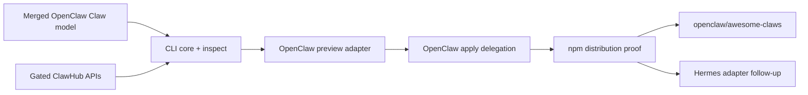

# Standalone Claws CLI PR Plan

This track builds the harness-neutral command shape Patrick described:

```bash
npx claws <claw> --agent openclaw
```

It targets the Claw package and profile model merged through OpenClaw PR
#112773 plus the portable prompt contract in RFC addendum #48. A non-empty
`CLAW.md` body is the portable agent prompt; OpenClaw maps it to managed
`SOUL.md`. The standalone CLI validates and preserves that portable contract
without owning OpenClaw's workspace lifecycle.

## Private Incubation Guardrails

The distribution name is not decided. Until the Foundation selects or secures
one, development uses the private standalone repository at
`C:\src\standalone-claw-cli-prototype`, with no remote, npm publication
configuration, or claim on the unscoped `claws` name.
Examples using `npx claws` describe the desired command shape, not a reserved
package identity or a published command.

The first evidence slice owns an independent private reference package inside
the standalone repository. OpenClaw does not consume or define that parser;
both sides revalidate at their own trust boundaries. Public release still
requires independent versioning, governance, and conformance ownership.

## Current Incubation Slice

The private standalone repository combines the CLI core, OpenClaw preview,
exact ClawHub resolution, consented apply, and private distribution-proof
evidence slices at signed commit `764bf30a46f0`. It uses private packages
`@claws/reference-private` and `@claws/cli-private`,
version `0.0.0-private`, and temporary binary `claws-dev`. It accepts local
package directories and exact immutable ClawHub coordinates. Preview delegates
to canonical OpenClaw planning; apply requires the exact reviewed
`planIntegrity` and delegates mutation to canonical OpenClaw add. The registry
URL remains explicit until the experimental feed is deployed. It does not
publish or select the final repository/package name.

The preview/apply bridge has real lifecycle proof through stale-consent
rejection, apply, status, remove, and empty final provenance. Its immutable
content-addressed snapshot cache is private, time- and size-bounded, and
cross-process serialized. OpenClaw remains the sole owner of host policy,
mutation, provenance, update, status, doctor, and removal semantics.

`pnpm proof:pack` now verifies the exact private tarball surface, installs it
offline into a fresh prefix, proves the experimental gate, and invokes the
installed npm bin. The same packed bin has delegated a real OpenClaw preview
under WSL2 Node 24.15 using disposable host state. This is distribution
evidence only: trusted publishing, a final package identity, and a public
repository remain deferred.

The current private readiness head is signed commit `764bf30a46f0`. It adds
ungated help/version, installed OpenClaw discovery on Windows, structured host
diagnostics, bounded timeout semantics, an isolated real-OpenClaw packed proof,
and a concise reviewer brief. Its final independent review is clean after
fixing Windows percent-path preservation and quote-based shim injection.

Draft OpenClaw [#113836](https://github.com/openclaw/openclaw/pull/113836) is
superseded. The standalone adapter invokes OpenClaw's public JSON CLI instead
of importing its parser or private lifecycle modules.

## Boundaries

The standalone CLI owns:

- source and exact-version resolution;
- artifact download and integrity verification;
- portable package validation and normalized inspection;
- harness selection and adapter dispatch;
- stable cross-harness command and outcome conventions.

Each harness adapter owns or delegates:

- host policy and capability consent;
- credentials and local prerequisites;
- planning and mutation;
- provenance, update, status, doctor, and removal;
- harness-specific profiles and configuration.

The OpenClaw adapter must invoke the merged `openclaw claws` lifecycle rather
than importing private OpenClaw modules or recreating its ownership rules.

## Ordered PR Track

### 0. Repository and package setup - Foundation task, deferred during private incubation

- Create `openclaw/claws` or the finally selected repository only after naming
  and public-incubation approval.
- Create the selected npm package with required 2FA and trusted publishing only
  after that approval.
- In parallel, request a voluntary transfer of the occupied unscoped `claws`
  package. The scoped package is the guaranteed path and the transfer does not
  block implementation.

### 1. CLI core and inspect - `openclaw/claws`

- Add the executable, argument parser, typed result envelope, and adapter API.
- Accept a local package path and an exact ClawHub package coordinate.
- Resolve immutable artifact bytes, verify the advertised digest, extract with
  bounded path-safe rules, and inspect the current merged Claw schema.
- Implement `claws <claw> --agent openclaw --dry-run` command parsing without
  mutation; the OpenClaw adapter may initially report that execution support is
  not installed.
- Add shared fixtures for valid packages, malformed manifests, unsafe archives,
  unsupported schema versions, and unknown adapters.

Private slice 1 first proved local package directories. The follow-on signed
slice now resolves exact ClawHub coordinates through the official experimental
feed, verifies immutable artifact bytes, safely extracts legacy ZIP and
npm-pack archives, and revalidates package identity before adapter dispatch.

### 2. OpenClaw preview adapter - `openclaw/claws`

- Discover a compatible installed `openclaw` executable and its experimental
  Claws capability.
- Pass the verified local package to canonical `openclaw claws inspect` and
  `openclaw claws add --dry-run --json` commands.
- Normalize only the cross-harness outcome envelope; preserve the complete
  harness-native plan for user review.
- Forward exit, blocker, and diagnostic outcomes without interpreting
  OpenClaw's private provenance or ownership state.
- Prove local-path and real ClawHub artifacts on Linux, macOS, and Windows.

### 3. OpenClaw apply delegation - `openclaw/claws`

- Add explicit confirmation and delegate mutation to canonical
  `openclaw claws add --yes` with the reviewed plan-integrity value.
- Never broaden consent, retry an uncertain mutation automatically, or claim
  rollback beyond the harness result.
- Stream human output and return stable machine-readable wrapper outcomes.
- Prove preview-to-apply integrity invalidation, successful apply, partial
  outcome propagation, and a clean status/remove round trip through OpenClaw.

### 4. npm distribution and launch proof - `openclaw/claws`

- Publish `@openclaw/claws` through npm trusted publishing with provenance.
- Prove the clean-machine command:

  ```bash
  npx @openclaw/claws <claw> --agent openclaw --dry-run
  ```

- If the unscoped transfer succeeds, publish the same signed CLI as `claws` and
  prove `npx claws <claw> --agent openclaw`.
- Document version compatibility, telemetry boundaries, update behavior, and
  the fact that OpenClaw remains experimental-gated until graduation.

### 5. Launch collection - new `openclaw/awesome-claws` repository

- Seed a broad curated set, not only three examples. The private local
  prototype currently contains 15 role-specific Claws across engineering,
  analysis, operations, productivity, product, and governance.
- Validate every contribution with the released reference CLI, secret scanning,
  exact dependency checks, and OpenClaw dry-run proof.
- Link exact ClawHub releases after the ClawHub experiment is enabled.
- Use GitHub for readable curation and contributions; retain ClawHub for
  immutable publication, discovery, moderation, and telemetry.

Private evidence lives at `C:\src\awesome-claws-private-prototype` at signed
commit `6e206f321658`. All 15 packages pass independent reference inspection and
exact generated-tree checks; five representative categories also return ready,
non-mutating plans from real OpenClaw. The repository has no remote and makes
no public namespace claim.

### 6. Hermes adapter - separate follow-up

- Define the adapter with Hermes owners using the same package fixtures and
  outcome envelope.
- Add `--agent hermes` only after real preview/apply proof.
- Keep translation in the adapter; evolve `CLAW.md` separately when evidence
  shows the current portable subset is insufficient.

## Dependencies



## Decisions Deferred

- The final repository, npm package, and executable names.
- Whether harnesses other than OpenClaw map the portable `CLAW.md` body to a
  file, configuration field, or another native instruction primitive.
- Whether executable task sections belong in the root document or a separate
  automation format.
- The unscoped npm package transfer and `agentclaws.io` domain ownership.
- Stable v1 graduation and removal of OpenClaw or ClawHub experimental gates.

These decisions can revise the versioned package reader and adapters later;
they do not block proving the standalone CLI against today's merged model.
