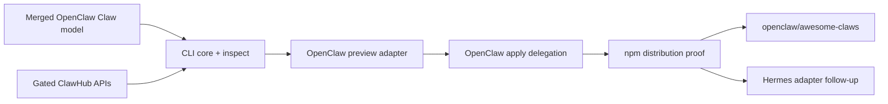

# Standalone Claws CLI PR Plan

This track builds the harness-neutral command Patrick described:

```bash
npx claws <claw> --agent openclaw
```

It targets the Claw package and profile model merged through OpenClaw PR
#112773. It does not change the current `CLAW.md` body semantics. The format may
evolve later through its RFC and versioned adapter contract without requiring
the standalone CLI to own a second lifecycle implementation.

## Boundaries

The standalone CLI owns:

- source and exact-version resolution;
- artifact download and integrity verification;
- portable package validation and normalized inspection;
- harness selection and adapter dispatch;
- stable cross-harness command and outcome conventions.

Each harness adapter owns or delegates:

- host policy and capability consent;
- credentials and local prerequisites;
- planning and mutation;
- provenance, update, status, doctor, and removal;
- harness-specific profiles and configuration.

The OpenClaw adapter must invoke the merged `openclaw claws` lifecycle rather
than importing private OpenClaw modules or recreating its ownership rules.

## Ordered PR Track

### 0. Repository and package setup - Foundation task

- Create `openclaw/claws` with the OpenClaw security and contribution baseline.
- Create the public `@openclaw/claws` npm package with required 2FA and trusted
  publishing.
- In parallel, request a voluntary transfer of the occupied unscoped `claws`
  package. The scoped package is the guaranteed path and the transfer does not
  block implementation.

### 1. CLI core and inspect - `openclaw/claws`

- Add the executable, argument parser, typed result envelope, and adapter API.
- Accept a local package path and an exact ClawHub package coordinate.
- Resolve immutable artifact bytes, verify the advertised digest, extract with
  bounded path-safe rules, and inspect the current merged Claw schema.
- Implement `claws <claw> --agent openclaw --dry-run` command parsing without
  mutation; the OpenClaw adapter may initially report that execution support is
  not installed.
- Add shared fixtures for valid packages, malformed manifests, unsafe archives,
  unsupported schema versions, and unknown adapters.

### 2. OpenClaw preview adapter - `openclaw/claws`

- Discover a compatible installed `openclaw` executable and its experimental
  Claws capability.
- Pass the verified local package to canonical `openclaw claws inspect` and
  `openclaw claws add --dry-run --json` commands.
- Normalize only the cross-harness outcome envelope; preserve the complete
  harness-native plan for user review.
- Forward exit, blocker, and diagnostic outcomes without interpreting
  OpenClaw's private provenance or ownership state.
- Prove local-path and real ClawHub artifacts on Linux, macOS, and Windows.

### 3. OpenClaw apply delegation - `openclaw/claws`

- Add explicit confirmation and delegate mutation to canonical
  `openclaw claws add --yes` with the reviewed plan-integrity value.
- Never broaden consent, retry an uncertain mutation automatically, or claim
  rollback beyond the harness result.
- Stream human output and return stable machine-readable wrapper outcomes.
- Prove preview-to-apply integrity invalidation, successful apply, partial
  outcome propagation, and a clean status/remove round trip through OpenClaw.

### 4. npm distribution and launch proof - `openclaw/claws`

- Publish `@openclaw/claws` through npm trusted publishing with provenance.
- Prove the clean-machine command:

  ```bash
  npx @openclaw/claws <claw> --agent openclaw --dry-run
  ```

- If the unscoped transfer succeeds, publish the same signed CLI as `claws` and
  prove `npx claws <claw> --agent openclaw`.
- Document version compatibility, telemetry boundaries, update behavior, and
  the fact that OpenClaw remains experimental-gated until graduation.

### 5. Launch collection - new `openclaw/awesome-claws` repository

- Seed incident-response, financial-analyst, and customer-support Claws.
- Validate every contribution with the released reference CLI, secret scanning,
  exact dependency checks, and OpenClaw dry-run proof.
- Link exact ClawHub releases after the ClawHub experiment is enabled.
- Use GitHub for readable curation and contributions; retain ClawHub for
  immutable publication, discovery, moderation, and telemetry.

### 6. Hermes adapter - separate follow-up

- Define the adapter with Hermes owners using the same package fixtures and
  outcome envelope.
- Add `--agent hermes` only after real preview/apply proof.
- Keep translation in the adapter; evolve `CLAW.md` separately when evidence
  shows the current portable subset is insufficient.

## Dependencies



## Decisions Deferred

- Whether the `CLAW.md` body remains documentation, becomes `SOUL.md`, or gains
  another portable prompt mapping.
- Whether executable task sections belong in the root document or a separate
  automation format.
- The unscoped npm package transfer and `agentclaws.io` domain ownership.
- Stable v1 graduation and removal of OpenClaw or ClawHub experimental gates.

These decisions can revise the versioned package reader and adapters later;
they do not block proving the standalone CLI against today's merged model.
