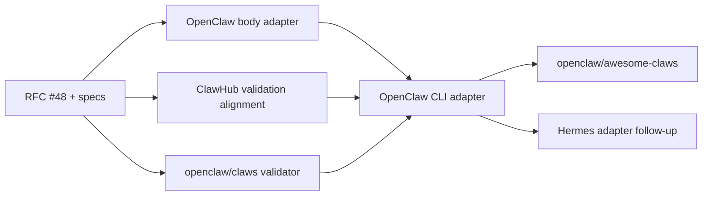

# Portable Claws Follow-up PR Plan

This track turns the experimental OpenClaw Claw package into a readable,
harness-neutral format without replacing the lifecycle implementation already
owned by OpenClaw. It follows RFC 0016 and its open addendum in RFC PR #48.

## Product Thesis

The smallest useful Claw is one `CLAW.md` that a person can understand. YAML
frontmatter declares portable composition; the Markdown body is the normative
agent prompt. A richer package may add conventional workspace files and
harness-specific profiles.

OpenClaw maps the package deterministically:

| Portable package content | OpenClaw destination |
| --- | --- |
| `CLAW.md` frontmatter | Agent identity and portable resource declarations |
| `CLAW.md` Markdown body | `SOUL.md` |
| `AGENTS.md`, `TOOLS.md`, `HEARTBEAT.md`, and other declared workspace files | Same canonical workspace destination |
| `profiles/openclaw.yml` | Package-local OpenClaw adapter input; never copied as ordinary host config |

A package must not declare a second `SOUL.md` when `CLAW.md` has a body. Apply,
update, status, doctor, remove, and export continue to use the harness's native
lifecycle and provenance implementation.

## Ordered PR Track

### 0. RFC and specifications - `openclaw/rfcs` PR #48

- Make the Markdown body normative portable agent instructions.
- Define deterministic body-to-`SOUL.md` materialization and export round trip.
- Define the duplicate-`SOUL.md` rejection rule and package integrity behavior.
- Separate portable conformance from OpenClaw lifecycle and profile behavior.
- Record the standalone CLI, launch repository, and adapter sequence below.

### 1. Portable body adapter - `openclaw/openclaw`

- Parse the body as a bounded UTF-8 prompt and expose it in inspect/dry-run.
- Materialize it through the existing managed workspace-file planner as
  `SOUL.md`; do not add a second write or ownership implementation.
- Reject body plus declared `SOUL.md` ambiguity before mutation.
- Export the managed, unchanged `SOUL.md` as the canonical body and prove
  export/add/update/remove round trip.
- Keep the entire surface behind `OPENCLAW_EXPERIMENTAL_CLAWS=1`.

### 2. Registry alignment - `openclaw/clawhub` PRs #3089 and #3090

- Share fixtures for normative body parsing, size limits, and duplicate
  `SOUL.md` rejection.
- Validate exact body bytes as part of the immutable package artifact.
- Keep publication and every public read surface behind
  `CLAWHUB_EXPERIMENTAL_CLAWS=1`.
- Complete this before enabling the ClawHub experiment for users.

### 3. Reference CLI foundation - new `openclaw/claws` repository

- Publish a real package as `@openclaw/claws` while the Foundation separately
  pursues voluntary transfer of the occupied unscoped `claws` npm package.
- Add a harness-neutral package reader, validator, normalized inspect output,
  conformance fixtures, and an adapter interface.
- Implement `npx @openclaw/claws <claw> --agent openclaw --dry-run` first.
- Do not own credentials, host policy, provenance, or mutation semantics.

### 4. OpenClaw execution adapter - `openclaw/claws`

- Resolve an exact local or registry Claw artifact and verify its integrity.
- Delegate preview and apply to the installed OpenClaw CLI.
- Demonstrate `npx claws <claw> --agent openclaw` if the unscoped package
  transfer succeeds; retain the scoped command as the guaranteed path.
- Define adapter conformance using observable plans and outcomes rather than
  OpenClaw internal APIs.

### 5. Launch collection - new `openclaw/awesome-claws` repository

- Seed the repository with the three validated starter Claws: incident
  response, financial analysis, and customer support.
- Require package validation, secret scanning, exact dependency versions, and
  OpenClaw dry-run proof in CI.
- Link each Claw to its exact ClawHub release when publication is enabled.
- Treat GitHub as the readable contribution and curation surface; ClawHub
  remains the immutable publication, search, and telemetry surface.

### 6. Additional harness adapter - separate follow-up

- Add `--agent hermes` only with Hermes-owner participation and conformance
  fixtures proving the portable subset.
- Keep harness-specific translation in the adapter; do not add Hermes fields
  to the portable core merely to complete a demo.

## Dependencies

## Launch Gate

Public launch requires the OpenClaw body round trip, ClawHub disabled/enabled
proof, the reference validator, one real OpenClaw command path, and maintained
starter Claws. The unscoped npm transfer, Hermes adapter, and removal of either
experimental gate are not launch blockers.
