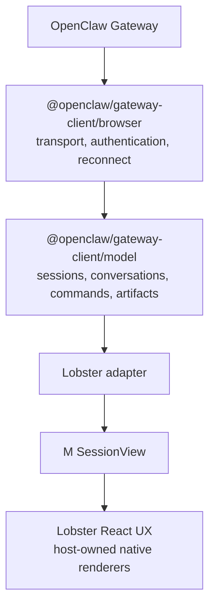
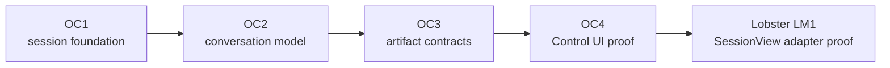

### User signal

[Generative UX #2511](https://github.com/gim-home/m/issues/2511) prefers native
React rendering for first-party experiences, structured tool output, and a
swappable renderer with sandboxed iframe fallback. The One Scout UX decisions
also establish that the shared renderer is passive and consumes
`SessionView` snapshots ([#5427](https://github.com/gim-home/m/issues/5427),
[#5468](https://github.com/gim-home/m/issues/5468)).

### Problem

We want Lobster/M to own the native React experience rather than host or fork
OpenClaw's Lit Control UI. Today the reusable OpenClaw surface stops at the
Gateway client. If each product folds raw Gateway history and live events into
UI state independently, we duplicate reconnect, ordering, tool lifecycle,
approval, and compatibility behavior.

### Possible direction

Use the proposed framework-neutral `@openclaw/gateway-client/model` layer above
the existing browser transport subpath. OpenClaw would own immutable
session/conversation snapshots, typed commands, history/live reconciliation,
and renderer-neutral UI artifacts. Lobster would adapt those snapshots into the
already-selected M `SessionView` vocabulary and retain React composition,
Fluent/M365 theming, tenant integration, telemetry, and rollout.

For GenUX, a tool result can carry structured data plus an opaque template URI.
The host maps allowlisted first-party URIs to native React components. Unknown
or third-party artifacts retain text output or use an explicit sandboxed MCP
App fallback. Components never receive authority directly; actions return
through typed model commands and OpenClaw server authorization.

This does **not** introduce a second M view model, require JSON Render, or move
M/Lobster components into OpenClaw.

### Capability split

Installed and enabled OpenClaw extensions determine which artifacts and
structured results can be produced. OpenClaw core/extensions expose all
applicable renderer-neutral views for that artifact. The client determines
which view it wants, which native renderers it has installed and trusts, and
how the selected projection maps into its own view model. The Control Model
does not invent either capability; it carries the available views and preserves
native, structured, or MCP App fallback behavior. Client capability
advertisement can filter/rank offers but is not authorization or component
installation.

"All views" means all authorized applicable descriptors, not eager computation
of every payload. Lobster selects one compatible offer; OpenClaw materializes
only that deferred view. Discovery must not reveal hidden extensions or tools,
and extensions do not receive the client's complete renderer inventory.

### Fork implementation evidence

The proposed OpenClaw boundary is available as four stacked fork-only drafts:

1. [OC1: Gateway Client model foundation](https://github.com/giodl73-repo/openclaw/pull/230)
2. [OC2: conversation model and commands](https://github.com/giodl73-repo/openclaw/pull/231)
3. [OC3: renderer-neutral UI artifacts](https://github.com/giodl73-repo/openclaw/pull/232)
4. [OC4: Control UI reference adoption](https://github.com/giodl73-repo/openclaw/pull/238)

The drafts demonstrate that the model can live in Gateway Client core without
making it a Gateway plugin or importing Control UI. They remain design evidence,
not accepted upstream surfaces.

### Progress to date

The bounded evidence series is now complete in fork-local drafts:

1. [L0](https://microsoft.ghe.com/bic/lobster/pull/8165) temporarily carries
   the Control Model into Lobster.
2. [LM1](https://microsoft.ghe.com/giodl/lobster/pull/63) adapts canonical
   conversation snapshots into the existing `SessionView`.
3. [LM2](https://microsoft.ghe.com/giodl/lobster/pull/64) renders one exact
   allowlisted native table artifact with bounded schema and visible fallback.
4. [LM3](https://microsoft.ghe.com/giodl/lobster/pull/65) routes a native
   Refresh action through the Control Model and rejects stale or denied actions.
5. [LM4](https://microsoft.ghe.com/giodl/lobster/pull/66) routes ordinary sends
   through `ControlModelConversation.send`.
6. [LM5](https://microsoft.ghe.com/giodl/lobster/pull/67) routes active-run
   aborts through `ControlModelConversation.abort`.
7. [LM6](https://microsoft.ghe.com/giodl/lobster/pull/68) hydrates selected
   history through an explicitly refreshed canonical conversation snapshot.

This demonstrates state, streaming, tools, artifacts, native actions, send,
abort, reconnect, and history while deleting equivalent Lobster Gateway
behavior. The series stops at LM6. Remaining raw lanes are host-owned
operational/security, session administration, memory, or compatibility paths,
not equivalent Control Model reducers.

### Boundary corrections

- OpenClaw already owns dashboards, board identity, registered widget
  providers, layout, persistence, focus/docking, and the `show_widget` and
  `dashboard` tools. Lobster should host those dashboard routes first; a future
  native surface should project the existing board model rather than rebuild
  dashboards from generic artifacts.
- Canvas and MCP Apps remain explicit sandboxed fallbacks.
- Settings are governed control-plane state, not conversation artifacts.
  Lobster should host OpenClaw settings first, read-only where it lacks secure
  write authority, then consume a separate descriptor/provenance-aware Config
  Model backed by Managed Configuration.

### Next steps

1. Review the fork RFC and OC1-OC4 evidence with the OpenClaw owners; keep it
   fork-only while RFC intake is frozen.
2. Define publication ownership, compatibility, package acceptance, and
   security gates for the optional Gateway Client model subpaths.
3. Replace Lobster's temporary source carry with a released dependency, resolve
   required CI, and land LM1-LM6 behind a runtime flag with rollback.
4. Run a live hosted-Gateway proof and add safe telemetry, Fluent/a11y/localized
   quality, and shareable screenshots or recordings.
5. Use hosted OpenClaw dashboards and settings immediately. Treat native
   dashboard projection and the Config Model as separate owner-first slices.
6. Defer cross-client user-message correlation until it is a concrete product
   requirement with one identity/retry contract.

### Acceptance sketch

- The shared UX imports no OpenClaw Lit component or private Control UI module.
- React components do not parse raw Gateway events.
- M continues to expose `SessionView` to the renderer.
- Lobster can select among OpenClaw-provided views without making its selection
  canonical for other clients.
- Native artifact rendering is host-registered and schema validated.
- Extension presence and client renderer support are tested independently.
- Unselected deferred views are not materialized or charged to the request.
- Third-party executable UI remains sandboxed.
- Duplicate raw ordinary-send, active-run abort, and selected-session history
  paths are deleted in the evidence stack.

### Related

- #2511
- #5427
- #5466
- #5468
- #5507
- [Fork-only OpenClaw RFC review](https://github.com/giodl73-repo/rfcs/pull/8)
- [OC1](https://github.com/giodl73-repo/openclaw/pull/230)
- [OC2](https://github.com/giodl73-repo/openclaw/pull/231)
- [OC3](https://github.com/giodl73-repo/openclaw/pull/232)
- [OC4](https://github.com/giodl73-repo/openclaw/pull/238)
