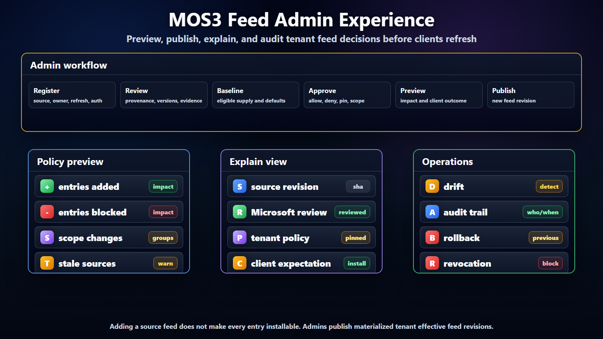

# MOS3 Feed Admin Experience



## Purpose

This document describes the tenant and deployment admin experience for MOS3 feed
composition. It focuses on the workflows admins need, not the UI layout or
implementation details.

The goal is to let admins curate many source catalogs into tenant effective
feeds that approved clients can consume.

## What Changes For Admins

MOS3 may already have manual controls that look feed-like: an admin can make a
package, title, skill, connector, or acquisition visible or unavailable for a
set of users. Those controls should stay in the admin and registry model.

The feed addition is that those settings become part of a materialized effective
view. Admins are no longer only editing isolated records. They can preview and
publish the actual view clients will consume after MOS3 combines source
catalogs, Microsoft review, package defense, tenant policy, group/surface
scope, pins, denies, revocations, and personal eligibility.

For admins, the new value is not "another place to click approve." The value is
confidence that one decision in MOS3 becomes a consistent searchable,
installable, auditable result across Scout, Chat/Cowork, VS Code/GitHub
Copilot, OpenClaw, and other clients.

## Admin Jobs

Admins need to answer five questions:

1. Which source catalogs are eligible?
2. Which entries are reviewed or trusted enough to consider?
3. Which entries are approved, denied, pinned, or scoped for my tenant?
4. Which clients and groups can see or install each entry?
5. What changed, who changed it, and what will clients do after refresh?

The admin experience should optimize for repeatable governance, not one-off
catalog editing. Admins should be able to configure source eligibility, preview
the resulting tenant effective feed, publish it, and explain the outcome later.

## Admin Roles

The deployment admin controls the broad supply posture: eligible sources, global
baselines, defaults, and enterprise-wide denies. The tenant admin narrows that
supply for a tenant with allow, deny, pin, scope, and audit decisions.

Security reviewers focus on source trust, scan results, risk metadata, and
revocation events. Microsoft curators attach Microsoft review state and curated
defaults. Helpdesk and operator roles need enough visibility to inspect feed
state, client refresh state, and installed-entry drift without becoming policy
owners.

## Core Workflows

### 1. Register Source Feeds

The admin or registry owner can register a source feed such as ClawHub, GitHub
Copilot marketplace, MOS3 public catalog, an internal Microsoft catalog, or a
partner catalog.

For skills and plugins, source registration should assume npm-backed packages
by default. The source can be a public npm scope, GitHub Packages, Azure
Artifacts, a private npm-compatible registry, or a richer catalog that resolves
to exact npm package coordinates. Registering that source does not make every
package installable. It only makes the source eligible for MOS3 import, review,
and tenant curation.

The registration should capture:

- source identity;
- source owner;
- feed URL or import mechanism;
- npm registry or package scope where applicable;
- refresh cadence;
- authentication requirements;
- expected integrity or signature;
- allowed entry kinds;
- default trust posture.

### 2. Review Imported Entries

After MOS3 imports a source feed, admins and curators should see imported
entries with provenance, version, publisher, source revision, compatibility, and
current review state.

Review should distinguish:

- source exists;
- source is authenticated;
- feed integrity is valid;
- package defense state is current;
- Microsoft review exists;
- tenant approval exists;
- runtime safety is known or unknown.

These states should not collapse into one "safe" flag.

### Package Defense

Admins and Microsoft curators need a package defense view for npm-backed skills
and plugins. The view should show the package coordinate, selected version,
registry, publisher, provenance status, integrity result, dependency risk,
vulnerability signals, malware signals, stale scan status, and any quarantine
reason. This can be implemented through existing Microsoft security services,
npm signals, GitHub security signals, or MOS3-owned review infrastructure. The
important product requirement is that admins see evidence and outcome, not an
opaque pass/fail badge.

Package defense should be able to quarantine an entry before it becomes
eligible for tenant approval. It should also be able to trigger recheck when a
new vulnerability, publisher compromise, dependency change, or source
revocation appears after approval.

### 3. Build A Baseline

Deployment admins can create a baseline feed that defines eligible supply before
tenant-specific narrowing.

Baseline actions:

- include source feed;
- exclude source feed;
- include Microsoft curated feed;
- deny entry globally;
- require Microsoft review;
- require package defense pass or explicit exception;
- restrict by kind, surface, publisher, or compatibility;
- define default refresh behavior.

### 4. Approve Tenant Effective Feed

Tenant admins can narrow the baseline into the tenant effective feed.

Tenant actions:

- allow entry;
- deny entry;
- pin version;
- approve only for selected groups;
- approve only for selected surfaces;
- approve only for selected environments;
- deprecate entry for users while keeping existing installs visible;
- request review or exception.

The output is a materialized tenant effective feed with a version, timestamp,
source revisions, and audit trail.

In the current Lobster proof, that output is represented by a signed
`tenantApproved` Scout `FeedDocument`. PR #3236 hosts the materialized document
at `/v1/scout/feeds/approved.json`, configured by
`LOBSTER_SCOUT_APPROVED_FEED_PATH`, and validates that the feed's tenant hash
matches the authenticated caller. The admin experience still needs to own the
composition and publish workflow that writes or serves that materialized feed.

Personal publishing should be treated as a related but narrower workflow. A
user can publish or acquire a package through an approved upstream surface, but
the client should consume a signed user-scoped projection. PR #3238 models that
projection at `/v1/scout/feeds/personal.json`, configured by
`LOBSTER_SCOUT_PERSONAL_FEED_DIR`, with tenant and user hash checks.

### 5. Preview And Publish

Before publishing a tenant effective feed, admins should be able to preview:

- entries added;
- entries removed;
- entries newly denied or revoked;
- entries newly pinned or unpinned;
- package versions or npm scopes affected;
- package defense warnings, quarantine decisions, or recheck requirements;
- surfaces, groups, environments, or devices affected;
- expected client behavior after refresh.

Publishing should create a new feed revision. The previous known-good revision
should remain available for diagnostics and emergency rollback where policy
allows.

For the hosted feed stack, publish also means atomically replacing the
pre-materialized signed feed artifact or service response that Lobster will
serve. Publishing should not require clients to understand the source catalog
or MOS3 acquisition API. Clients should only need to refresh the effective feed
URL.

### 6. Handle Revocation

Revocation should be explicit and visible.

When an entry is revoked, admins should see:

- reason;
- source of revocation;
- affected tenants;
- affected clients;
- affected installed versions where known;
- whether new discovery is blocked;
- whether new install is blocked;
- whether active session termination is required or delegated to clients.

Default behavior should block new discovery and new install after feed refresh.
Active session termination remains a client/runtime enforcement decision.

### 7. Investigate Drift

Admins and operators need to investigate differences between current feed state
and client state.

Common drift cases:

- client has not refreshed the current tenant effective feed;
- client has an installed version that differs from the pinned version;
- user or device scope changed after install;
- entry was revoked after install;
- installed entry lacks source provenance or feed revision metadata.

Drift investigation should point admins to the feed revision, client refresh
time, installed version, and policy reason.

## Admin Views

The admin experience should give operators a few coherent views. Source feeds
show registered sources, owners, refresh state, last revision, and integrity
status. Imported entries show the raw source view next to normalized MOS3
records. Curated feed views show Microsoft-reviewed entries and the evidence
attached to them. Baseline views show eligible supply and deployment-wide
defaults. Tenant effective feed views show the final tenant-approved feed
version.

Admins also need exception, drift, and audit views. Exceptions collect entries
that need review, override, or security decisions. Drift views show installed
or cached client state that differs from the current feed state. Audit views
answer who changed source, baseline, tenant policy, pin, deny, or revocation
state.

## Policy Preview

Admins need a dry-run capability before publishing policy changes.

The preview should answer:

- how many entries will become visible;
- how many entries will become hidden or blocked;
- which users, groups, devices, environments, or surfaces are affected;
- which installed entries may become drifted;
- whether any pinned versions are older than upstream current versions;
- whether any approved package now has a defense warning, quarantine, or recheck
  requirement;
- whether any entries depend on stale or failed source feeds.

Preview is especially important for source feed onboarding because adding a
source feed must not automatically make the full source installable.

## Admin Action Outcomes

Admin actions should map to predictable client outcomes.

| Admin action | Feed effect | Expected client outcome |
| --- | --- | --- |
| Register source feed | Source can be imported. | No entry becomes installable by registration alone. |
| Include in baseline | Source or entry becomes eligible. | Entry still requires tenant approval unless policy says otherwise. |
| Allow entry | Tenant state becomes allowed. | Entry can become searchable or installable if scope and compatibility match. |
| Deny entry | Tenant state becomes denied. | Entry is hidden or blocked for new discovery and install. |
| Pin version | Selected version is fixed. | Client presents pinned version and does not auto-upgrade beyond it. |
| Scope entry | Surfaces, groups, devices, or environments are restricted. | Client hides or blocks outside the configured scope. |
| Revoke entry | Distribution state becomes revoked. | Client blocks new discovery and new install after refresh. |
| Deprecate entry | Distribution state becomes deprecated. | Client may warn, lower ranking, or guide to replacement. |

## Admin Guardrails

The admin experience should prevent accidental broadening:

- adding a source feed should not automatically make all entries installable;
- search should not silently include unapproved feeds;
- tenant deny should override curated or baseline inclusion;
- revoked entries should not become visible because of stale source metadata;
- personal feeds should require explicit admission and policy;
- feed refresh failures should preserve the previous effective feed and mark it
  stale rather than widening access.

## Diagnostics

Admins need an explain view for every entry:

```text
Entry: clawhub.openclaw.excel-review
Source: ClawHub reviewed feed at revision sha256:...
Microsoft review: reviewed
Deployment baseline: included
Tenant policy: allowed, pinned to 1.4.2
Scope: engineering group, Scout and VS Code
Distribution: visible
Client expectation: searchable and installable for scoped users after refresh
```

This explain view is critical for support, security review, and partner
alignment.

Hosted-feed diagnostics should also answer which route served the feed, which
feed scope was expected, which tenant or user hash was matched, which feed
revision or attestation was verified, and whether the response came from the
current materialized feed or a stale previous-good revision.

## Audit Requirements

Audit records should capture:

- actor;
- timestamp;
- source feed, baseline feed, tenant feed, or entry affected;
- before and after state;
- reason or ticket reference where available;
- feed revision produced by the change;
- affected surfaces or scopes.

Audit should distinguish Microsoft curation actions from tenant admin actions.
It should also distinguish policy changes from feed refresh events.

## Success Criteria

The admin experience is working when:

- admins can configure source eligibility once and project it to multiple
  clients;
- tenant admins can approve, deny, pin, scope, and revoke without knowing each
  source API;
- admins can explain why an entry is visible, hidden, blocked, or pinned;
- audit history shows who changed feed, review, tenant, and revocation state;
- clients receive a materialized tenant effective feed rather than broad source
  catalogs.
- a tenant-approved feed can be published to the hosted effective-feed endpoint
  without exposing raw tenant IDs;
- a user-scoped personal feed can be projected separately from tenant approval
  without turning local folders into unmanaged enterprise distribution.
