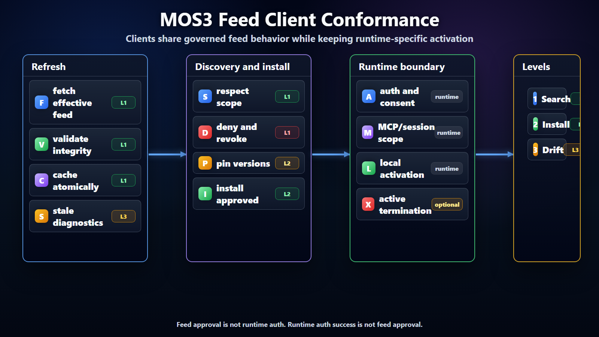

# MOS3 Feed Client Conformance



## Purpose

This document defines what a client must do to consume MOS3 tenant effective
feeds correctly. It applies to Scout, Chat, Cowork, VS Code/GitHub Copilot,
OpenClaw, Aether, and any other client that uses MOS3 feeds for governed
discovery or install.

The goal is consistent client behavior without requiring every client to share
the same runtime, install mechanism, or execution model.

## What The Feed Is For

The feed is the client-facing effective view of MOS3 decisions. It is not a
replacement for MOS3 APIs that manage authoring, acquisition, assignment,
publisher records, admin configuration, or package lifecycle.

A client should use the feed when it needs to answer governed discovery and
install questions:

- what entries are visible for this tenant, user, group, surface, or region;
- which version is approved or pinned;
- whether the entry is denied, revoked, deprecated, blocked, or out of scope;
- which source, review, package defense, and attestation evidence produced the
  outcome.

A client can still use richer MOS3 APIs for workflows that need live mutation
or record management. The conformance point is that clients should not each
invent their own feed-like filtering over raw registry state when MOS3 can
materialize the effective view once.

## Client Responsibilities

A conforming client must:

- consume only configured effective feeds for governed enterprise discovery;
- validate feed identity, schema version, revision, and integrity where
  provided;
- preserve entry ID, version, source, and governance metadata in local cache or
  install records;
- respect denied, revoked, scoped, and pinned states for new discovery and new
  install;
- avoid silently searching unapproved source feeds;
- expose feed age, feed revision, and last refresh status in diagnostics;
- report local drift when installed or active state differs from the current
  effective feed.

For the current Scout feed stack, a client can start with two hosted Lobster
feed projections. `/v1/scout/feeds/approved.json` is the tenant-approved feed
for governed discovery and install. `/v1/scout/feeds/personal.json` is the
user-scoped personal feed projection for packages the signed-in user authored
or acquired through approved upstream surfaces. Both routes should be treated
as effective feeds, not as source catalog search endpoints.

Clients should fail closed for install when they cannot determine whether an
entry is in scope, approved, denied, revoked, or pinned. Discovery can be more
lenient only if the UI clearly labels the uncertainty and does not imply install
approval.

## Discovery Conformance

For governed enterprise discovery, a client should search tenant effective feeds
by default. Entries outside the user's group, device, surface, or environment
scope should be hidden or blocked. Revoked and denied entries should not appear
as available. Deprecated entries may remain visible, but the client should warn,
lower ranking, or guide users toward a replacement. Pinned entries should show
the pinned version as the approved version. If the feed is stale, the client may
continue using the cached feed only with visible stale diagnostics.

Clients may support a separate public or exploratory search mode, but it must be
visibly distinct from tenant-approved enterprise discovery and must not make
entries installable unless policy permits.

If a client combines tenant-approved and personal feeds, the UI and diagnostics
should preserve which feed authorized each entry. Tenant-approved entries and
personal entries can both be searchable, but they have different governance
meaning. A personal entry is not automatically tenant-approved for other users
or other surfaces.

## Install Conformance

For install or acquisition, a client should:

- install only versions approved by the effective feed;
- for skill and plugin entries, acquire the exact npm package coordinate and
  version from the feed rather than resolving mutable npm tags at install time;
- treat pinned version as intentional, even if a newer upstream version exists;
- reject install when entry is denied, revoked, out of scope, or missing required
  integrity metadata;
- reject install when package defense state is quarantined or failed unless the
  feed carries an explicit allowed exception outcome;
- record the feed revision used for install;
- record source provenance and selected version;
- surface a clear reason when install is blocked by policy.

Install does not imply runtime activation. A client may install an entry but
still require user consent, admin consent, authentication, workspace selection,
or runtime compatibility checks before activation.

For npm-backed skills and plugins, clients may use npm libraries, package
manager tooling, or registry APIs to acquire the package. That acquisition path
must remain subordinate to the MOS3 effective feed. Public npm search, source
dist-tags, or locally cached newer versions must not override the approved
package version and integrity in the feed.

When install is blocked, the client should report the specific reason:

- denied by tenant;
- revoked;
- out of scope;
- unsupported surface;
- unsupported runtime or transport;
- stale feed;
- missing integrity evidence;
- package defense quarantine or failure;
- version not approved or not pinned.

## Runtime Conformance

Runtime behavior remains client-specific, but clients should expose the boundary
between feed state and runtime state.

Visible means an entry may appear in search or catalog UI. Installable means the
client may acquire the approved version if runtime prerequisites pass. Pinned
means the client should not auto-upgrade beyond the selected version. Revoked
means new discovery and new install are blocked after refresh. Deprecated means
the client may warn, suppress ranking, or guide users to a replacement. Out of
scope means the client hides or blocks the entry for that user or environment.

Active session termination is not required by the feed contract unless a client
or tenant policy explicitly adds that enforcement mode.

Runtime activation should preserve the feed entry ID and version in logs or
diagnostics so support can connect runtime behavior back to the feed decision.
Where practical, diagnostics should also preserve package defense state and
scan revision so support can explain why an entry was blocked, warned, or
allowed by exception.

## Refresh Behavior

Clients should refresh feeds on a defined cadence and on explicit user or admin
request where practical.

Refresh should:

- fetch configured effective feed revisions;
- validate schema and integrity;
- update local cache atomically;
- preserve previous good feed if refresh fails;
- report feed age and last refresh error;
- recompute local search index after successful refresh;
- compare installed entries against current feed state.

Refresh failures should not widen access. If a client cannot refresh the
effective feed, it should keep the previous good feed, mark it stale, and avoid
installing entries whose approval cannot be confirmed within the configured
freshness window.

## Source And Auth Boundaries

Clients should not use source credentials or marketplace APIs as a shortcut
around MOS3 governance.

Source credentials should be used only when the client is explicitly allowed to
access the source. Entra auth provides tenant and user identity for scoped
access. GitHub auth should be used for GitHub-backed acquisition only when the
effective feed permits that path. Service auth remains part of connector or
agent activation according to runtime policy.

Authentication success does not imply feed approval. Feed approval does not
remove the need for runtime authentication or consent.

## Drift Reporting

Clients should detect and report drift:

Drift occurs when local state no longer matches the current effective feed. A
user might have version `1.5.0` installed while the tenant feed pins `1.4.2`.
An entry might have been installed before revocation and now be blocked for new
install. A user or device might no longer match the effective feed scope. The
client feed might be older than the allowed freshness window. An installed
entry might also lack source or feed revision metadata, which makes support and
audit harder.

Drift reporting can power admin diagnostics, client warnings, and later
enforcement decisions.

## Diagnostics

A conforming client should provide enough diagnostics to answer:

- which feed was used;
- which feed revision was used;
- when it last refreshed;
- whether refresh succeeded;
- why an entry is visible, hidden, installable, or blocked;
- which source and source revision produced the entry;
- whether local install state matches the effective feed.

Example diagnostic output:

```text
Entry: clawhub.openclaw.excel-review
Feed: tenant-effective.contoso
Feed revision: 2026-06-16T18:00:00Z.sha256:...
Source: clawhub.reviewed at sha256:...
Governance: reviewed, tenant allowed, pinned, visible
Scope: engineering group, vscode
Client state: installed 1.4.2, matches approved version
```

For the hosted Scout routes, diagnostics should also include the route used,
the feed scope (`tenantApproved` or `personal`), feed attestation status, and
whether tenant and user scope were evaluated by the service or by the client.

## Compatibility Expectations

Clients do not need identical runtime behavior, but they should agree on how to
interpret feed metadata.

The `kind` field tells the client whether the entry is a skill, plugin, MCP
server, connector, or agent. Surface compatibility tells the client whether the
entry is intended for that product. Transport compatibility matters especially
for MCP clients, because local loopback, remote MCP, and per-session
availability can differ. Session scope tells the client whether availability is
per session, workspace, user, device, or tenant. Governance scope should be
enforced wherever the client has enough identity context to do so.

## Required Versus Optional Behavior

At Level 1, the client must read tenant effective feeds and respect deny,
revoke, and scope decisions in discovery. At Level 2, the client must install
only approved versions, preserve source/version/feed revision metadata, and
report blocked install reasons. At Level 3, the client reports drift and feed
freshness.

Active session termination after revocation is optional and policy-dependent.
Public source feed search is also optional, but it must be visibly separate from
governed tenant discovery.

## Conformance Test Matrix

Each client should be able to pass a small shared test matrix.

| Scenario | Expected result |
| --- | --- |
| Tenant effective feed includes allowed entry in scope. | Entry appears in governed discovery. |
| Entry is denied by tenant. | Entry is hidden or blocked for discovery and install. |
| Entry is revoked after prior install. | New discovery and new install are blocked after refresh. |
| Entry is pinned to an older version. | Client shows and installs only the pinned version. |
| Entry is scoped to another surface. | Client hides or blocks the entry. |
| Feed refresh fails. | Client keeps previous good feed, marks stale, and does not widen access. |
| Feed integrity check fails. | Client rejects the new feed revision and reports the error. |
| Public source feed search is enabled. | Results are visibly separate from tenant-approved discovery. |
| Runtime activation requires auth. | Client does not treat feed approval as auth or consent. |

## Non-Conformance Examples

A client is not conforming if it:

- searches public source feeds by default when a tenant effective feed is
  configured;
- installs a version newer than the tenant-pinned version without override;
- hides review, tenant, and revocation states behind one generic approved flag;
- ignores revoked or denied entries for new install;
- cannot explain which feed revision authorized an installed entry;
- treats feed visibility as permission to bypass runtime consent or auth.

## Conformance Levels

Level 0 is experimental search only. Level 1 means the client can search tenant
effective feeds and respect scope, deny, and revoke for discovery. Level 2 means
the client can install approved entries and record source, version, feed
revision, and governance metadata. Level 3 means the client can report drift,
feed freshness, blocked install reasons, and runtime/feed mismatches.

Level 2 is the minimum useful enterprise conformance target. Level 3 is the
target for admin supportability.

The current Scout Desktop bridge is an experimental Level 0 to Level 1 proof:
it can load a feed or MOS3 catalog export/snapshot input, verify feed
attestation when present, map skill entries into the Extensions catalog, and
preserve install URL metadata. The next conformance step is to point it at the
hosted tenant-approved endpoint once #3236 lands, then add blocked install
reasons and feed revision diagnostics.
