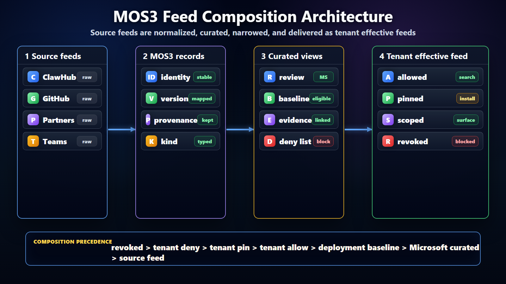

# MOS3 Feed Composition Architecture



## Purpose

This note captures the architecture behind the MOS3 feed composition position.
The position paper answers why feeds should be the enterprise model. This note
answers how the model can work across sources, MOS3, tenant administration, and
clients.

## Existing MOS3 Capabilities And Feed Additions

MOS3 should not treat feeds as a replacement for its registry, metadata store,
acquisition model, or user/admin settings. Those are the authority. Feeds are
the projection layer that makes the authority consumable by clients.

The same boundary applies to artifact systems such as DV. Feeds are not the
artifact write path and not the permission source for artifact mutation. A feed
can reference an artifact, package, title, connector, or skill and expose the
effective discovery/install outcome, but ownership, write access, acquisition,
assignment, and artifact lifecycle remain with MOS3 and the underlying artifact
authority.

MOS3 already has or is expected to have several ingredients:

- package, title, skill, connector, and agent metadata;
- user acquisition and entitlement state;
- publisher and source metadata;
- tenant or admin configuration;
- review, policy, assignment, or visibility decisions;
- APIs that clients or services can use to query the current state.

Feeds add the missing cross-client distribution contract:

- deterministic composition across N source catalogs and MOS3 records;
- materialized effective views for tenant, group, user, surface, environment,
  or region;
- signed feed identity, revision, scope, and freshness;
- explicit allow, deny, pin, revoke, review, package defense, and compatibility
  outcomes;
- a stable cacheable/searchable payload that clients can consume without
  reimplementing every source API and policy rule;
- operational hooks for refresh, stale state, rollback, audit, and diagnostics.

The architecture is therefore not:

```text
MOS3 metadata OR feeds
```

It is:

```text
MOS3 metadata + policy decisions -> feed composition -> effective client view
```

## Principles

- Keep source publication separate from tenant approval.
- Use npm packages as the default package unit for skills and plugins.
- Preserve provenance from source feed through client consumption.
- Make tenant effective feeds materialized artifacts, not client-side guesses.
- Treat search visibility, install permission, and runtime execution as separate
  decisions.
- Allow clients to keep runtime-specific activation and enforcement.
- Make revocation and pinning explicit, auditable, and observable.

## Scope Boundaries

MOS3 feed composition standardizes catalog and governance behavior. It does not
standardize every runtime capability. For skills and plugins, it should
standardize around exact npm package references as the default package
coordinate. That does not force one runtime. It gives the registry, admin
plane, and clients a reusable package unit to govern.

MOS3 owns the feed-side decision: what appears in the effective feed, what
version is approved, which surfaces are allowed, which entries are denied or
revoked, and which source and review evidence produced the decision. Clients
own the local experience around that decision: search UI, ranking, package
acquisition, local install mechanics, tool loading, MCP connection behavior,
skill materialization, telemetry, and any live runtime unload.

The practical boundary is simple. MOS3 should be able to say "this entry is
approved, pinned, scoped, deprecated, or revoked for this tenant." The client
should decide how that appears in the product and how the local runtime enforces
it.

## Current Implementation Status

The current Lobster/Scout stack now covers four feed layers:

1. PR #1944 adds a local Scout feed CLI and a narrow approved-feed skill
   install path into an OpenClaw-compatible target directory.
2. PR #3170 imports MOS3 catalog export data into the Scout `FeedDocument`
   contract.
3. PR #3221, merged on 2026-06-17, imports live MOS3 acquisitions into Scout
   feeds, preserving MOS3 metadata such as title, asset, acquisition, connector,
   and skill path fields.
4. PR #3236 hosts a signed tenant-approved effective feed at
   `/v1/scout/feeds/approved.json`; PR #3238 adds the stacked user-scoped
   personal feed projection at `/v1/scout/feeds/personal.json`.

This is not yet the full MOS3 composition service. It is a concrete bridge:
MOS3-derived records become signed Scout feeds, Lobster can serve an effective
feed behind tenant auth, and clients can consume a stable feed document without
directly implementing every MOS3 source API.

## System Shape

```text
Source catalogs and feeds
  ClawHub, GitHub Copilot marketplace, MOS3 public catalog,
  partner catalogs, internal catalogs, team feeds, later user feeds

        |
        v

MOS3 ingestion and normalization
  identity, metadata, provenance, compatibility, review state,
  source revision, integrity, revocation, deprecation

        |
        v

MOS3 feed composition
  Microsoft curated feeds, deployment baselines,
  tenant effective feeds, group/surface/environment views

        |
        v

Clients
  Scout, Chat, Cowork, VS Code/GitHub Copilot, OpenClaw, Aether
```

## Feed Types

The model starts with source feeds. A source feed is the view published by an
origin such as ClawHub, GitHub, MOS3 public catalog, a partner catalog, an
internal catalog, or a team catalog. MOS3 ingests those source feeds and builds
a normalized root index before enterprise or tenant rules are applied.

Microsoft curated feeds are the first governed layer. They represent entries
with Microsoft review, compatibility, and curation metadata attached. Deployment
baseline feeds then define the eligible supply selected by Microsoft or a
deployment admin.

The tenant effective feed is the most important enterprise artifact. It is the
final tenant-approved view after allow, deny, pin, scope, review, and revocation
rules are applied. Clients should use this feed for governed discovery and
install.

Team and group feeds should come after the tenant effective feed model is
proven. Team feeds can represent a business unit or engineering org. Personal
feeds should be treated as user-scoped effective-feed projections, admitted only
through provenance, review, and tenant policy. The current #3238 slice models
the projection route and caller-bound scope check; it does not create a broad
publishing API.

```text
Imported source feeds
  -> root index
  -> Microsoft curated feed
  -> deployment baseline feed
  -> tenant effective feed
  -> client cache/search index
```

## Composition Rules

Feed composition should be deterministic and auditable. A tenant effective feed
is produced by applying rules in a known order:

```text
1. Import eligible source feeds.
2. Normalize source entries into MOS3 records.
3. Apply Microsoft review and compatibility metadata.
4. Apply deployment baseline inclusion and exclusion rules.
5. Apply tenant allow, deny, pin, and scope rules.
6. Resolve version selection and conflicts.
7. Emit a versioned tenant effective feed with provenance and audit metadata.
```

Suggested rule precedence:

1. A revoked entry is excluded from new discovery and new install.
2. A tenant deny excludes the entry even if it appears in a curated or baseline
   feed.
3. A tenant pin selects the approved version unless that version is revoked.
4. A tenant allow includes an entry only if source and baseline rules permit it.
5. A deployment baseline defines eligible supply before tenant narrowing.
6. A Microsoft curated feed adds review state and default eligibility, but does
   not replace tenant approval.
7. A source feed supplies original metadata and artifact coordinates.

This order keeps revocation and explicit tenant denial stronger than broad
curation. It also keeps source publication weaker than enterprise approval.

## Roles And Authority

The package producer creates the skill, plugin, connector, agent, artifact, or
metadata. For skills and plugins, the producer should usually publish an npm
package that contains the implementation and a capability manifest. The source
supplier exposes that package through a source catalog or source feed. MOS3, as
registry owner, normalizes records, tracks source revisions, holds review
state, and exposes distribution APIs.

Microsoft curators attach review evidence and produce reviewed views. Deployment
admins select eligible source feeds, baselines, and defaults. Tenant admins
narrow that supply with allow, deny, pin, and scope rules. Tenant users consume
the resulting effective feed through approved clients. The client reads,
verifies, searches, and hands install or activation to its runtime.

```text
Deployment admin owns eligible supply.
Tenant admin owns tenant approval and narrowing.
End users consume the materialized approved feed.
Clients own runtime install and execution.
```

## RBAC Model To Validate

The feed service should reuse MOS3 RBAC and assignment decisions instead of
creating a second authorization model. The architecture depends on a clear map
from actor to allowed operation:

- **Read effective feed:** a signed-in user, client, or service principal can
  read only the tenant, user, group, or surface feed it is authorized to see.
- **Publish personal package:** a user can publish only packages they own or
  have explicit publishing rights for.
- **Manage package or source:** a package owner, source owner, or registry
  owner can update metadata, source registration, refresh settings, and
  publisher records.
- **Curate Microsoft baseline:** a Microsoft curator can attach review,
  package defense state, baseline eligibility, and Microsoft curated defaults.
- **Administer tenant feed:** a tenant admin can allow, deny, pin, scope,
  revoke, preview, and publish the tenant effective view.
- **Operate and audit:** an operator or auditor can inspect revisions, drift,
  policy reasons, refresh failures, and audit events without changing the
  effective policy.

The open implementation question is which of these are already represented in
MOS3 today through acquisitions, assignments, owner ACLs, admin center roles,
service principals, or existing registry permissions. Feed generation should
call those systems for authorization and should include enough provenance in
the feed and audit trail to explain which role or assignment produced each
decision.

## Lifecycle

```text
1. Source publishes package and catalog entry
2. MOS3 imports source feed and records package provenance
3. MOS3 normalizes identity, kind, version, compatibility, and npm install metadata
4. Package defense evaluates provenance, integrity, dependency risk, and malware signals
5. Microsoft review attaches security, compliance, quality, and surface metadata
6. Deployment baseline selects eligible sources and entries
7. Tenant admin applies allow, deny, pin, and scope rules
8. MOS3 materializes tenant effective feed
9. Client refreshes feed, indexes metadata, and exposes approved discovery
10. Client runtime handles install, activation, update, and execution enforcement
```

This lifecycle keeps MOS3 responsible for registry composition and governance
metadata while keeping client runtimes responsible for local execution behavior.

## Runtime Lifetimes

Different clients will have different runtime lifetimes. The feed contract
should make those differences visible rather than pretending they do not exist.

For a skill, the feed can approve metadata and an exact npm package reference,
but some runtimes will materialize skills into a workspace while others may
attach them to a session. For a plugin, the feed can approve the npm package
and activation metadata, while loading behavior and permission prompts remain
client-specific.

For an MCP server, the feed can approve the server reference, transport
metadata, and policy state. Local loopback MCP, remote MCP, and per-session MCP
availability can still differ by client. For connectors, the feed can approve
identity and governance metadata, while connector auth, environment scope, and
data access may be managed elsewhere. For agents, the feed can approve identity
and capability metadata, while orchestration and delegated permissions remain
surface-specific.

For revocation, the default feed-level guarantee should be "blocked for new
discovery and new install after refresh." Stopping an already-running session,
disconnecting an active MCP server, or unloading an installed plugin is a
separate runtime enforcement decision.

## State Model

Entries should expose separate state fields instead of one overloaded
"approved" value.

Source state answers whether MOS3 imported the source entry, whether the source
is missing or stale, and whether the source itself has revoked the entry. Review
state answers whether Microsoft has reviewed, rejected, or marked the entry for
recheck. Tenant state answers whether a tenant has allowed, denied, pinned, or
scoped the entry. Distribution state answers whether the entry should be
visible, hidden, deprecated, or revoked. Client state answers what the local
client can do with the entry, such as search, install, update, block, or report
drift.

Keeping those states separate helps PM, security, tenant admins, and client
owners discuss the same entry without confusing source availability, review
status, tenant policy, and runtime behavior.

Package defense state should be distinct as well. A package may be present,
well-formed, and signed while still being quarantined because of a vulnerability,
malware signal, publisher anomaly, unexpected dependency expansion, or missing
provenance. MOS3 should expose that state to curators and admins instead of
hiding it inside generic review status.

## Trust Boundaries

The first trust boundary is source trust: who published the source feed and how
MOS3 authenticates it. The second is feed integrity: whether the imported or
materialized feed matches the expected revision or hash. The third is package
defense: whether the npm package and its dependency closure have acceptable
integrity, provenance, vulnerability, malware, and publisher-risk signals. The
fourth is Microsoft review: whether Microsoft has attached review evidence or
curation status. The fifth is tenant approval: whether a tenant has allowed,
denied, pinned, or scoped the entry. The final boundary is runtime enforcement:
whether the client blocks install, activation, or execution.

These boundaries should not be collapsed. A signed source feed is not the same
as package defense. Package defense is not the same as Microsoft review.
Microsoft review is not the same as tenant approval. Tenant approval is not the
same as runtime safety.

## Operational Model

MOS3 can support both pull and push integration patterns:

- pull: MOS3 periodically refreshes registered source feeds, records source
  revisions, recomposes affected effective feeds, and exposes updated feed
  versions to clients;
- push: a source notifies MOS3 that a feed revision changed, then MOS3 imports
  and recomposes;
- snapshot: a static feed artifact is imported for review, testing, or private
  tenant distribution.

The initial posture should favor pull plus snapshot. Pull is easier for tenant
governance because MOS3 controls refresh cadence, retry behavior, and audit.
Snapshot support is useful for proving the contract before hosted source
infrastructure exists. The stack now has both proof points: static MOS3 catalog
exports through #3170 and live MOS3 acquisition import through #3221, with
hosted tenant-approved serving in #3236.

## ClawHub Import Flow

```text
ClawHub source feed
  package metadata, versions, npm coordinates, install references, provenance

        |
        v

MOS3 imported source feed
  source identity, ingestion timestamp, normalized schema, scan state,
  package defense state

        |
        v

Microsoft reviewed feed
  review decision, compatibility, security/compliance metadata,
  allowed surfaces, deprecation and revocation state

        |
        v

Tenant effective feed
  tenant approval, pinned versions, deny overrides,
  group/surface scope, admin audit trail

        |
        v

Client consumption
  Scout, Chat, Cowork, VS Code/GitHub Copilot, OpenClaw
```

## Learnings From Feed Branches

The OpenClaw and Scout feed branches point to several practical requirements:

- Source feeds need stable IDs so admins can govern sources by durable identity,
  not raw URLs.
- Feed integrity matters. OpenClaw models unsigned and pinned feeds with
  optional `sha256` integrity, but attestation proves document integrity, not
  package safety.
- npm reuse requires package defense. Exact package coordinates are useful only
  if MOS3 can evaluate integrity, provenance, dependency risk, and revocation
  signals before broad tenant eligibility.
- Search is not install. A feed can make an entry visible without automatically
  installing or activating it.
- Policy is not enforcement. Clients can report policy state, while blocking
  and runtime termination remain separate enforcement choices.
- Defaults must be explicit. Search should not silently widen to new feeds.
- Tenant materialization matters. Clients should consume a tenant effective feed
  rather than downloading and filtering large public catalogs.
- Tenant privacy matters. Scout/Lobster designs use tenant hashes in feed
  artifacts, not raw tenant IDs.
- Static feeds and snapshot imports are useful. They let teams prove the
  contract before hosted infrastructure is complete.

## Propagation And Revocation

Feeds can model propagation up and down.

```text
Contribution -> source feed -> MOS3 ingestion -> review/curation
             -> tenant effective feed -> client availability
```

```text
Policy or revocation decision -> feed recomposition -> effective feed version
                              -> client refresh -> new installs blocked or updated
```

Revocation should first affect new sessions and new installs. Terminating
existing sessions is a separate enforcement decision and should be explicit.
Pinned versions should also be explicit. If upstream publishes `1.5.0` but the
tenant pins `1.4.2`, clients should report that the tenant is intentionally
pinned rather than treating the update as automatically available.

## Failure Modes

The architecture should define predictable behavior for common failures:

If a source feed is unavailable, MOS3 should keep the last known imported
revision, mark the source stale, and avoid silently widening supply. If a source
entry disappears, MOS3 should preserve the historical record, mark the entry
missing or source-revoked, and require a policy decision for installed copies.

If feed integrity does not match the expected revision or hash, MOS3 should
reject the import, keep the previous trusted revision, and surface an alert. If
tenant effective feed generation fails, MOS3 should continue serving the
previous effective feed version with a stale marker. If a client refresh fails,
the client should continue using its cached effective feed and report age.

When revocation arrives, the default behavior should be to block new discovery
and new install after refresh. Active session handling remains a separate
runtime enforcement decision.

## Client Contract

The effective feed should answer:

- what the entry is;
- whether it is a skill, plugin, MCP server, connector, or agent;
- where it came from;
- which version is approved;
- how it is installed or activated;
- which surfaces can consume it;
- whether it is reviewed, pinned, deprecated, revoked, or blocked;
- which source revision and feed attestation produced it.

The stable contract is identity, kind, version, source, package coordinate,
install or activation, compatibility, governance, and feed integrity.

For the current Scout implementation, the concrete envelope is Lobster's
`FeedDocument`. The hosted tenant-approved route serves only signed feeds with
`tenantApproved` scope and a tenant hash matching the authenticated caller. The
personal projection route serves only signed feeds with `personal` scope and
both tenant and user hashes matching the caller. Both routes are read-only,
materialized feed projections.

Clients should treat the contract as input to local behavior, not as a complete
runtime implementation. At minimum, a compliant client should:

- refresh configured effective feeds on a defined cadence;
- expose feed age and source revision in diagnostics;
- respect revoked, denied, scoped, and pinned states for new discovery and new
  install;
- avoid silently searching unapproved source feeds;
- preserve the entry ID and version when installing or activating a capability;
- report when local runtime state differs from feed state, such as installed
  version behind pinned version or active entry later revoked.

Example shape:

```json
{
  "id": "clawhub.openclaw.excel-review",
  "kind": "skill",
  "name": "Excel Review",
  "version": "1.4.2",
  "publisher": "Example Team",
  "source": {
    "type": "clawhub",
    "feed": "https://clawhub.example/feeds/reviewed.json",
    "entryId": "excel-review",
    "revision": "clawhub-snapshot:sha256:..."
  },
  "install": {
    "type": "npm",
    "registry": "https://registry.npmjs.org/",
    "package": "@clawhub/skill-excel-review",
    "version": "1.4.2",
    "tarball": "https://registry.npmjs.org/@clawhub/skill-excel-review/-/skill-excel-review-1.4.2.tgz",
    "integrity": "sha512-..."
  },
  "governance": {
    "reviewedBy": "microsoft",
    "tenantApproved": true,
    "pinned": true,
    "revoked": false,
    "allowedSurfaces": ["scout", "vscode", "openclaw"]
  },
  "attestation": {
    "feedSha256": "..."
  }
}
```

## MVP

The practical first implementation has partially landed or is in review:

1. MOS3 catalog export import landed in #3170.
2. Live MOS3 acquisition import landed in #3221.
3. Signed feed document attestation and tenant hash scoping are in the feed
   contract and hosted route stack.
4. Tenant-approved hosted feed serving is in #3236.
5. Personal user-scoped feed serving is in #3238.
6. Scout Desktop consumption proof exists in ClawPilot PR #3542 using feed or
   snapshot input and feed attestation verification.

The remaining MVP gap is the admin composition surface: source eligibility,
tenant allow/deny/pin/scope rules, preview, audit, and managed materialization
of tenant effective feed files or service responses.

Defer runtime termination of active sessions, complex trust scoring, rich
marketplace UX, and broad user-published personal feeds until the feed contract
and tenant effective feed behavior are proven.

## Collaboration Questions

1. Does MOS3 own only the registry, or both registry and feed composition?
2. What is the minimum shared schema across plugins, skills, MCP servers,
   connectors, and agents?
3. Which sources are first class for Phase 1: MOS public, ClawHub, GitHub
   Copilot marketplace, internal Microsoft catalogs, partner connector catalogs?
4. What does Microsoft review mean, and which verification systems contribute
   evidence?
5. Are tenant admins approving entries, feeds, source catalogs, or all three?
6. What is the effective feed scope: tenant only, or tenant plus group, surface,
   environment, and device?
7. What is the revocation behavior for new sessions versus running sessions?
8. When can user or team feeds be admitted, and what signing/provenance policy
   is required?
9. Does MOS3 serve materialized effective feeds directly, or can Lobster and
   other control planes host effective feeds derived from MOS3 composition?

## Design Review Checklist

Use this checklist to decide whether the architecture is ready to move from
position to implementation planning:

- one source feed can be imported with stable source and entry IDs;
- entries preserve source provenance through the tenant effective feed;
- Microsoft review, tenant approval, revocation, and runtime enforcement are
  represented as separate states;
- rule precedence for deny, revoke, allow, and pin is agreed;
- tenant effective feeds can be materialized and versioned;
- clients can consume the effective feed without direct source-specific
  integration;
- stale source feeds, integrity failures, and refresh failures have defined
  behavior;
- the MVP explicitly separates discovery from install and install from runtime
  execution.
