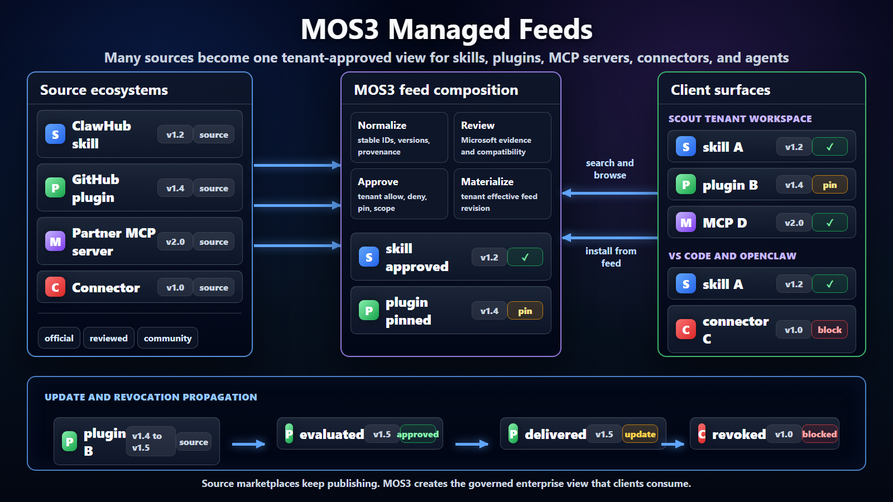

# MOS3 Feed Composition Position



## Executive Summary

Microsoft has many sources of agentic capability: MOS3 catalogs, ClawHub,
GitHub Copilot marketplace, internal Microsoft catalogs, partner connector
catalogs, team-owned packages, and eventually user-published skills. For skills
and plugins, the default package shape should be npm packages wherever
practical, because npm already gives publishers names, scopes, versions,
tarballs, integrity, provenance signals, and familiar developer tooling. Tenant
admins still need MOS3 to curate that package supply into something their users
can safely discover and use across Scout, Chat, Cowork, VS Code/GitHub Copilot,
OpenClaw, and other clients.

The position: MOS3 should own the shared enterprise registry and the feed
composition plane. The registry is the system of record. Feeds are the governed
views that Microsoft and tenant admins publish to clients. This lets Microsoft
support internal and external contributions without coupling every client to
every upstream marketplace or forcing each client to implement its own tenant
governance model.

```text
Problem: many sources, many clients, many tenant policies
Pattern: feeds compose, curate, cache, and distribute source indexes
Position: MOS3 registry plus MOS3 feed composition gives tenants one governed path
```

## One Paragraph Version

MOS3 can offer tenant admins a governed feed composition layer over many sources
of skills, plugins, MCP servers, connectors, and agents. Skills and plugins
should be npm packages by default, but clients should not treat arbitrary npm
search as enterprise-approved discovery. Instead, MOS3 can ingest npm-backed
packages and other source catalogs, preserve provenance and integrity, attach
Microsoft review and tenant policy, and publish tenant effective feeds that
clients consume for discovery and install. This makes feeds the additive
enterprise distribution model: source ecosystems can keep publishing with
standard package workflows, while MOS3 gives tenants one place to approve, pin,
revoke, scope, audit, and distribute capabilities across Microsoft surfaces.

## Decision Needed

The near-term decision is whether MOS3 should be treated only as a shared
registry, or as the shared registry plus the place where feed composition is
defined and materialized. The recommendation is registry plus composition.

This does not require MOS3 to replace ClawHub, GitHub, partner catalogs, or
team catalogs. MOS3 should ingest those sources, preserve provenance, attach
Microsoft review and tenant governance, and publish effective feeds that clients
can rely on.

The ask for the shared registry v-team is:

- agree that feeds are the cross-surface distribution contract;
- agree that MOS3 owns feed composition semantics, not just record storage;
- identify the first source feed to import and the first tenant effective feed
  to materialize;
- align Scout, Chat/Cowork, VS Code/GitHub Copilot, and OpenClaw on the minimum
  effective feed contract.

## Current Implementation Status

The Lobster/Scout feed stack now proves the first concrete slices of this
position. PR #3170 converts MOS3 catalog exports into Scout feed documents. PR
#3221, merged on 2026-06-17, imports live MOS3 acquisitions into Scout feeds
using MOS3 environment discovery and token-boundary handling. PR #3236 is the
hosted tenant-effective-feed slice: it serves a signed
`tenantApproved` Scout feed at `/v1/scout/feeds/approved.json` behind Lobster
auth, validates attestation and caller tenant scope, and sets `Cache-Control:
no-store`. PR #3238 is the personal projection slice: it adds a `personal`
feed scope and `/v1/scout/feeds/personal.json` for packages visible to a signed
in user, with hashed tenant and user partitioning. These PRs do not make
Lobster the MOS3 publishing plane. They prove the client-facing feed boundary
that MOS3 or a MOS3-backed control plane can materialize.

## Terms

For this discussion:

- source catalog means an origin where capabilities are published, such as
  ClawHub, GitHub, MOS3 public catalog, partner catalogs, or internal catalogs;
- source feed means a machine-readable view from one source catalog;
- Microsoft curated feed means a MOS3 view with Microsoft review and curation
  metadata attached;
- tenant effective feed means the final tenant-approved view after allow, deny,
  pin, scope, review, and revocation rules are applied;
- client means Scout, Chat, Cowork, VS Code/GitHub Copilot, OpenClaw, or another
  surface that consumes the effective feed.

## The Problem

The Super App direction brings Chat, Cowork, Code, and Scout closer together,
but extensibility is still fragmented. Skills, plugins, MCP servers,
connectors, and agents are packaged and governed differently across surfaces.
Admins need one place to approve, deny, pin, revoke, audit, and distribute
capabilities. Developers and teams need contribution paths that do not require
every client to build custom ingestion logic. Clients need a stable contract for
discovery, install, update, compatibility, and policy.

Without a composition layer, the integration shape becomes client by client:

```text
Scout        -> ClawHub, MOS3, internal catalogs, tenant policy
VS Code      -> ClawHub, GitHub marketplace, MOS3, tenant policy
Chat/Cowork  -> MOS3 catalog, connector systems, admin policy
OpenClaw     -> ClawHub, local config, enterprise feeds, policy
```

That multiplies policy logic and makes enterprise approval, revocation,
compatibility, and audit inconsistent.

The tenant admin should not have to ask which marketplace a capability comes
from or which client will consume it. The admin should be able to configure:

- eligible source catalogs;
- Microsoft-reviewed entries;
- tenant-private entries;
- pinned versions;
- denied or revoked entries;
- group, surface, device, or environment scope.

The output should be a tenant effective feed that approved clients consume.

## Why Feeds

Feeds solve a familiar systems problem: a producer publishes an index, an
intermediary curates or mirrors it, and consumers use the curated index rather
than talking to every origin directly.

```text
Source publication -> feed ingestion -> curation -> effective feed -> clients
```

This is how package registries, enterprise artifact feeds, app stores, advisory
feeds, blocklists, and content aggregators already work. The pattern gives us
five useful properties:

- source publication is separate from enterprise approval;
- upstream catalogs can be mirrored, filtered, pinned, and republished;
- clients consume one stable contract instead of every source API;
- revocation and risk metadata can propagate through a feed refresh;
- tenants receive materialized views instead of filtering broad public catalogs
  locally.

The same pattern fits plugins, skills, MCP servers, connectors, and agents. For
skills and plugins, the source artifact should usually be an npm package with a
capability manifest inside it. A source catalog can publish raw metadata around
that package. MOS3 can ingest and normalize it. Microsoft and tenant admins can
curate it. Clients can consume the effective feed without owning every upstream
integration or treating npm itself as the enterprise approval plane.

## Why MOS3

MOS3 is already positioned as the home for a shared M365 registry across Chat,
Cowork, GitHub Copilot/VS Code, Scout, and related surfaces. That makes it the
natural place to hold normalized records, source provenance, Microsoft review
state, tenant approval state, and distribution APIs.

The key distinction:

```text
MOS3 registry = source of truth
MOS3 feeds = governed views of that truth
MOS3 feed composition = enterprise control over many upstream catalogs
```

If MOS3 owns only records, each client or control plane still has to solve
composition, scope, pinning, revocation, and audit. If MOS3 owns the feed
composition model, clients can converge on one effective feed contract while
still retaining runtime-specific install and execution behavior.

This is additive to existing ecosystems. ClawHub can remain a source for
community or OpenClaw-oriented contributions. GitHub can remain a developer
marketplace. Partner catalogs can keep their connector-specific publishing
flows. MOS3 adds the enterprise layer that decides what is eligible, reviewed,
tenant-approved, scoped, and visible across Microsoft surfaces.

The same additive posture applies to packaging. MOS3 should not invent a new
package format for skills and plugins when npm packages are already a familiar
and reusable default. MOS3 feeds should reference exact npm package coordinates,
versions, tarball integrity, and provenance where available, then add the
enterprise decisions npm does not model: Microsoft review, tenant approval,
pinning, scope, revocation, audit, and client outcome.

There should also be a package defense layer before broad enterprise
eligibility. It does not need to be a new product called "npm Defender" on day
one, but the function is required. MOS3 needs a way to evaluate npm-backed
skills and plugins for publisher trust, package provenance, integrity, known
vulnerabilities, suspicious dependency changes, malware signals, policy
exceptions, and revocation triggers. That evidence should feed Microsoft review
and tenant policy without becoming a single opaque "safe" label.

## Stakeholder Value

For tenant admins, the value is a single place to configure eligible sources,
approvals, pins, denies, and scope. They should not need to learn the mechanics
of every upstream marketplace before deciding what their users can discover or
install.

For Microsoft curators, MOS3 feeds provide a place to attach review evidence
and curated defaults that can travel across surfaces. Review can become a
shared enterprise signal rather than a client-specific annotation.

For client teams, the value is one effective feed contract instead of custom
integrations with every source marketplace API. Scout, Chat/Cowork, VS Code,
GitHub Copilot, OpenClaw, and future clients can still keep their own runtime
behavior, but discovery and governance can converge.

For source ecosystems, this model is additive. ClawHub, GitHub, partner
catalogs, and private team catalogs can keep publishing. MOS3 adds enterprise
curation and tenant projection without replacing the source communities.

For security, compliance, developers, and teams, the value is traceability.
Package defense evidence, provenance, Microsoft review, tenant approval,
revocation, and runtime enforcement stay separate, while local or team
contributions have a visible path toward reviewed enterprise distribution.

## ClawHub Example

If a ClawHub feed is published into MOS3, MOS3 should not merely mirror it.
MOS3 should make it governable.

```text
ClawHub source feed
  -> MOS3 imported source feed
  -> Microsoft reviewed feed
  -> tenant effective feed
  -> Scout, Chat, Cowork, VS Code/GitHub Copilot, OpenClaw
```

An entry might originate in ClawHub, pass Microsoft review in MOS3, be approved
by a tenant admin, be pinned to version `1.4.2`, and become visible only to
Scout and VS Code users in selected groups. MOS3 should preserve that chain of
custody.

## Personal And Team Feeds

A user's local skills folder is an inventory, not automatically an enterprise
feed. It can become a personal feed only after it has stable identity, version,
publisher provenance, install reference, compatibility metadata, verification
state, policy flags, and integrity evidence.

For shared skills and plugins, the promotion path should normally package the
capability as npm first. A local folder can be useful during authoring, but the
shareable unit should become a versioned package with a capability manifest,
integrity, and provenance before MOS3 treats it as source supply.

The authoring convention should stay separate from tenant governance. Packages
declare capability intent. MOS3 and tenant effective feeds decide eligibility,
scope, and availability.

The implementation direction is now sharper: a personal feed is a user-scoped
effective view, not a raw local folder export. It can represent packages a user
authored, acquired, or has access to through MOS3-backed surfaces such as
Cowork and Scout. Lobster PR #3238 models that as a signed feed projection with
`personal` scope, hashed tenant and user identifiers, and exact caller checks.
The publishing act still belongs upstream in MOS3 or an approved package
workflow; the client-facing feed is the governed projection.

Recommended posture:

```text
Phase 1:
  Microsoft curated feeds
  Tenant effective feeds
  Imported private/source feeds

Phase 2:
  Team feeds
  User-scoped personal feed projections
  Promotion workflows from personal or team feeds to tenant approval
```

This supports sharing without turning every local folder into an uncontrolled
distribution channel.

## Non-Goals

This position does not require one universal runtime or one install mechanism.
For skills and plugins, npm packages should be the default reusable package
format. Scout, Chat, Cowork, VS Code/GitHub Copilot, OpenClaw, and other
clients can still keep runtime-specific activation and enforcement. The common
surface should be exact package references, discovery, provenance, approval,
compatibility, and policy metadata.

It also does not claim that feed attestation equals package safety. A feed can
prove where metadata came from and whether it was reviewed or approved. Package
safety still depends on verification, scanning, dependency risk assessment,
sandboxing, runtime policy, and security review.

## Success Criteria

This direction is working when:

- a tenant admin can configure approved sources once and have that decision
  reflected across multiple clients;
- a client can discover approved capabilities from a tenant effective feed
  without integrating directly with every upstream catalog;
- Microsoft review, tenant approval, pinning, revocation, and provenance are
  visible as separate states;
- a revoked or denied entry is blocked for new discovery and new install after
  feed refresh;
- a source such as ClawHub can contribute through MOS3 without losing chain of
  custody.

## Risks To Manage

- If feed composition semantics are left outside MOS3, every client will
  recreate them differently.
- If the tenant effective feed is not materialized, clients will need to fetch
  and filter broad catalogs locally, increasing privacy and consistency risk.
- If review, approval, and safety are collapsed into one flag, admins and
  security reviewers will lose the ability to reason about trust.
- If personal feeds are admitted too early, the model may look like unmanaged
  sharing rather than enterprise distribution.
- If clients treat feeds as runtime availability instead of governed discovery,
  meetings will conflate catalog policy with session lifetime and execution
  enforcement.

## Likely Objections

One likely objection is that MOS3 should only be the registry. The problem is
that a registry without composition still leaves tenants and clients to solve
policy projection independently. The registry is necessary, but the enterprise
value comes from turning many source records into governed tenant views.

Another objection is that existing marketplaces already have feeds or APIs.
That is true, and this proposal does not replace them. MOS3 feed composition
creates the tenant-approved enterprise view over those source APIs.

Client owners may also point out that Scout, Chat/Cowork, VS Code/GitHub
Copilot, OpenClaw, and other surfaces have different runtimes. The proposal
does not standardize runtime execution. It standardizes discovery and
governance metadata so each runtime can make consistent policy-aware decisions.

Personal feeds are a valid concern. They should be admitted as governed
user-scoped projections, not as an automatic consequence of a user having local
skills. Personal or team feeds should be admitted only through provenance,
review, and tenant policy.

## Recommendation

Adopt feeds as the distribution and governance model for MOS3 registry
composition. Start with source feeds, Microsoft curated feeds, deployment
baselines, and tenant effective feeds. Make the tenant effective feed the client
contract for governed discovery and install. Treat personal feeds as a
user-scoped effective-feed projection, with publishing and promotion governed
upstream.

Suggested phases:

```text
Phase 1: import source feeds and publish Microsoft curated feeds
Phase 2: materialize tenant effective feeds with allow, deny, pin, and scope
Phase 3: onboard more clients to the effective feed contract
Phase 4: add team feeds and personal-to-tenant promotion workflows
```

This gives Microsoft a coherent story for internal and external contributions,
tenant-level governance, cross-surface distribution, policy-aware revocation,
and local client search/install without coupling every client to every upstream
marketplace.

Detailed mechanics are covered in
`projects/feeds/mos3-feed-composition-architecture.md`.
