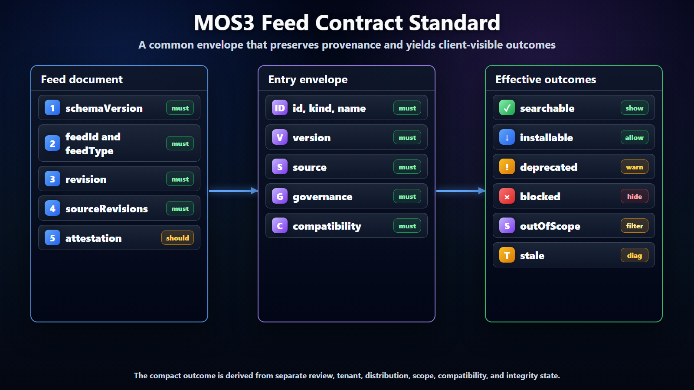

# MOS3 Feed Contract Standard



## Purpose

This document defines the minimum feed contract that MOS3, source catalogs, and
clients can align on. It is intentionally narrower than the architecture note:
it describes the shape and semantics of feed metadata, feed entries, governance
fields, integrity fields, and client-visible state.

The standard should let a client consume a tenant effective feed without knowing
which source catalog originally published each entry.

## Additive Contract

The feed contract is an additive contract over MOS3 registry state. It does not
move ownership of metadata, acquisition state, admin settings, assignments, or
policy decisions out of MOS3. Instead, it defines how MOS3 exposes the effective
result of those records and decisions to clients.

The contract also does not replace DV or any artifact authority. Artifact
storage, package writes, ownership changes, acquisition, assignment, and admin
mutation remain controlled by MOS3 and the systems that already authorize those
operations. A feed can reference the selected artifact or package and describe
the effective outcome, but it is not itself the write permission.

For a client, the feed should answer "what can this caller discover or install
now?" without requiring that client to reproduce MOS3 composition logic. For
MOS3, the feed should be a generated view with provenance back to the source
records, imported catalogs, admin choices, and review evidence that produced
it.

That makes the contract narrower and clearer:

- MOS3 remains the source of truth for records and decisions;
- feeds are versioned projections of the effective outcome;
- clients consume feeds for governed discovery and install;
- clients can still call richer MOS3 APIs when they need authoring, purchase,
  assignment, or management workflows.

Authorization for creating or mutating the underlying records is intentionally
outside the feed payload. Feed generation should be driven by MOS3 RBAC and
assignment checks. The feed should carry provenance and audit references that
let clients and admins explain the result, but clients must not treat the
presence of an entry as permission to bypass MOS3 write, acquisition, consent,
or runtime authorization flows.

## Contract Goals

- Provide stable identity across source imports, MOS3 normalization, tenant
  effective feeds, and client caches.
- Preserve provenance from source feed through tenant effective feed.
- Separate source publication, Microsoft review, tenant approval, distribution
  state, and runtime state.
- Support skills, plugins, MCP servers, connectors, and agents with one common
  envelope.
- Make revocation, denial, pinning, and scope visible to clients.
- Allow clients to search and install approved entries without direct
  source-specific integrations.

## Normative Language

This document uses these terms:

- must means required for feed contract conformance;
- should means strongly recommended and expected unless a partner documents an
  exception;
- may means optional behavior.

The contract is a metadata and governance contract. It does not require all
clients to share one runtime or one install mechanism. For skills and plugins,
however, the preferred package format is npm. The feed should govern exact npm
package references instead of asking each client to discover and evaluate
package supply independently.

## Feed Document

Every feed document must identify the contract it follows, the feed itself, the
type of feed being served, and the generated revision. In practice that means a
feed has a `schemaVersion`, `feedId`, `feedType`, `generatedAt`, and `revision`.
The revision can be monotonic or content-addressed, but clients must be able to
tell whether they are looking at the same feed snapshot as before.

A tenant feed must also carry tenant and scope information. When the feed is
exported or copied outside the service boundary, tenant references should be
opaque or hashed. The feed should list the source revisions used to generate it
so admins and clients can explain where a decision came from.

The feed body is the entry list. Attestation is strongly recommended: a hash,
signature, or equivalent evidence should let clients verify that the feed
document matches the expected producer and revision. Feeds should also include
`expiresAt` or `maxAgeSeconds` when clients need explicit freshness behavior.

The current Lobster/Scout implementation uses this pattern through
`FeedDocument`. It has stable feed identity, schema version, scope, generated
time, entries, and a feed attestation. The scope kinds now include root,
Lobster baseline, tenant approved, and personal. Tenant-approved feeds carry a
hashed tenant identifier. Personal feeds carry both hashed tenant and user
identifiers. Hosted routes validate those scope hashes against authenticated
claims before returning a feed.

Current hosted routes:

- `/v1/scout/feeds/approved.json` serves signed `tenantApproved` feeds for the
  caller tenant.
- `/v1/scout/feeds/personal.json` serves signed `personal` feeds for the caller
  tenant and user.

These routes are read-only projections over pre-materialized feeds. They do not
define the upstream publishing API.

## Entry Envelope

Every entry must have stable identity, type, name, selected version, publisher,
source provenance, compatibility, and governance metadata. The entry kind should
make clear whether the capability is a skill, plugin, MCP server, connector, or
agent.

Artifact-backed entries need install metadata. For skills and plugins, install
metadata should use npm coordinates by default: registry, package name, selected
version, tarball, and integrity. Runtime-backed or service-backed entries need
activation metadata. Descriptions are not required for correctness, but they are
recommended because feeds will power search, browse, and admin review
experiences.

The package itself should follow the npm authoring convention in
`mos3-feed-npm-authoring.md`: ordinary npm package metadata plus a sidecar
capability manifest that MOS3 can ingest.

Integrity metadata is recommended at both the feed and package level. For npm
packages, clients should use the package integrity value supplied by MOS3 and
should treat mutable npm tags as informational only. If only feed integrity is
available, clients should understand that the feed document is validated but
the package itself may still require separate verification.

## Identity Rules

Entry identity must be stable across feed refreshes. A normalized ID should not
change when display name, description, tags, or source metadata changes.

Recommended ID shape:

```text
<source-type>.<publisher-or-namespace>.<entry-name>
```

Examples:

```text
clawhub.openclaw.excel-review
github.contoso.pr-reviewer
mos3.microsoft.sharepoint-connector
```

If a source already has a durable ID, MOS3 should preserve it in `source.entryId`
and map it to a normalized `id`.

## Version Rules

The `version` field is the version selected by the feed. It may differ from the
latest upstream version when a tenant or deployment baseline pins an older
version.

Clients should treat:

- `version` as the approved version for this feed;
- `governance.pinned` as evidence that the selected version is intentional;
- `source.latestVersion` as informational, not automatically installable;
- revoked versions as blocked for new discovery and new install.

Feed revisions and entry versions are different concepts:

- feed revision identifies a generated feed snapshot;
- entry version identifies the approved artifact or capability version;
- source revision identifies the upstream source state imported into MOS3.

Clients must preserve all three when installing or activating an entry.

## State Values

State values should be constrained enough for clients to implement predictable
behavior.

Review state should distinguish unreviewed, reviewed, rejected, and needs
recheck. Tenant state should distinguish unset, allowed, denied, and exception
requested. Distribution state should distinguish visible, hidden, deprecated,
and revoked.

Package defense state should distinguish unscanned, scanning, passed, warning,
quarantined, failed, and recheck required. The state should include enough
reason metadata for admins to understand whether the issue is missing
provenance, a vulnerability, a malware signal, a publisher trust issue,
unexpected dependency expansion, or an integrity mismatch.

Compatibility should describe session scope using values like session,
workspace, user, device, or tenant. Install metadata should distinguish archive,
npm, registry, marketplace, local, and service acquisition. For skills and
plugins, `npm` should be the default install type unless there is a documented
exception. Activation metadata should distinguish skill, plugin, MCP server,
connector, agent, and external activation paths.

## Effective Outcome

The feed should make the client-visible outcome easy to compute. The detailed
state fields remain separate, but clients need a compact answer for discovery
and install.

The common outcomes are searchable, installable, blocked, deprecated, out of
scope, and stale. Searchable means the entry can appear in governed discovery
for the current scope. Installable means the client can acquire the selected
version. Blocked means the entry must not be installed and should not appear as
available. Deprecated means the entry may remain visible but should guide users
away from new use. Out of scope means the entry is valid in the feed but not for
this user, device, surface, or environment. Stale means the client or feed
freshness is outside the expected window.

The outcome should be derived from review, tenant, distribution, scope, and
compatibility state. It should not replace those fields.

## Provenance

The `source` object should include:

```json
{
  "type": "clawhub",
  "feedId": "clawhub.reviewed",
  "feedUrl": "https://clawhub.example/feeds/reviewed.json",
  "entryId": "excel-review",
  "revision": "sha256:...",
  "importedAt": "2026-06-16T18:00:00Z"
}
```

Source provenance should survive MOS3 normalization, Microsoft curation, tenant
approval, and client caching.

## Scope Semantics

Scope fields should be interpreted as restrictions, not suggestions. If a client
does not have enough identity or environment context to evaluate a scope, it
should fail closed for install and make discovery behavior explicit.

Examples:

- an entry scoped to `vscode` should not appear as installable in Scout;
- an entry scoped to `engineering` should not be installable for a user outside
  that group;
- an entry scoped to `prod` should not be installable in an unlisted
  environment unless an override is recorded.

For tenant and personal feed documents, raw tenant or user identifiers should
not appear in exported feed metadata. The implemented Scout feed contract uses
`sha256:`-prefixed hashes for tenant and user scope. Services can strip the
prefix for path partitioning, but the feed document should preserve the hash
scheme so diagnostics and clients can tell how the value was produced.

## Governance Fields

Governance state should be structured rather than collapsed into one approval
flag.

```json
{
  "review": {
    "state": "reviewed",
    "reviewedBy": "microsoft",
    "evidence": ["security-scan", "compatibility-check"]
  },
  "tenant": {
    "state": "allowed",
    "pinned": true,
    "approvedBy": "tenant-admin",
    "approvedAt": "2026-06-16T18:00:00Z"
  },
  "distribution": {
    "state": "visible",
    "revoked": false,
    "deprecated": false
  },
  "scope": {
    "surfaces": ["scout", "vscode", "openclaw"],
    "groups": ["engineering"],
    "environments": ["prod"]
  }
}
```

## Compatibility Fields

Compatibility should make runtime differences explicit.

At minimum, compatibility should say which surfaces may display or install the
entry, which runtimes are known to support it, and which transport modes apply
for MCP or service-backed entries. Compatibility should also say whether
availability is per session, workspace, user, device, or tenant, and whether
activation requires user, tenant, GitHub, Entra, or service authentication.

## Integrity And Attestation

Feed integrity and package integrity are separate.

Feed hash and feed signature tell the client that the feed document matches a
known generated revision and was produced by an expected publisher. Source
revision tells admins and clients which upstream source state produced the
entry. Artifact hash tells the client that the install artifact matches the
approved artifact. For npm-backed skills and plugins, npm integrity, registry
signature, provenance, and package audit signals can all contribute evidence,
but MOS3 still decides the enterprise outcome. Review evidence tells the admin
that a review or scan happened, but it does not alone prove runtime safety.

Clients should validate feed integrity before using a feed and artifact
integrity before install where artifact hashes are available.

Clients should treat quarantined or failed package defense state as blocked for
new discovery and new install unless the feed carries an explicit tenant or
Microsoft exception outcome. Warning state may remain visible, but the feed
should make the expected client outcome explicit.

## Evolution Rules

Schema evolution should preserve client safety:

- new optional fields may be added without changing `schemaVersion`;
- new required fields should require a schema version change;
- clients should ignore unknown optional fields;
- clients should reject feeds with unsupported major schema versions;
- deprecated fields should remain readable for at least one transition period.

## Example Entry

```json
{
  "id": "clawhub.openclaw.excel-review",
  "kind": "skill",
  "name": "Excel Review",
  "version": "1.4.2",
  "publisher": "Example Team",
  "source": {
    "type": "clawhub",
    "feedId": "clawhub.reviewed",
    "entryId": "excel-review",
    "revision": "sha256:..."
  },
  "install": {
    "type": "npm",
    "registry": "https://registry.npmjs.org/",
    "package": "@clawhub/skill-excel-review",
    "version": "1.4.2",
    "tarball": "https://registry.npmjs.org/@clawhub/skill-excel-review/-/skill-excel-review-1.4.2.tgz",
    "integrity": "sha512-..."
  },
  "compatibility": {
    "surfaces": ["scout", "vscode", "openclaw"],
    "runtimes": ["lobster-scout", "openclaw"],
    "sessionScope": "workspace"
  },
  "governance": {
    "review": {
      "state": "reviewed",
      "reviewedBy": "microsoft"
    },
    "packageDefense": {
      "state": "passed",
      "signals": ["integrity", "provenance", "vulnerability-scan"]
    },
    "tenant": {
      "state": "allowed",
      "pinned": true
    },
    "distribution": {
      "state": "visible",
      "revoked": false
    }
  }
}
```

## Conformance

A feed conforms to this standard when:

- every feed has stable identity, version, revision, source revision, and scope;
- every entry has stable ID, kind, version, source, package or activation
  reference, compatibility, and governance fields;
- skill and plugin entries use exact npm package coordinates by default;
- source provenance is preserved after composition;
- review, tenant, distribution, and runtime states are not collapsed;
- package defense state is represented separately from review and tenant
  approval;
- revocation and pinning are represented explicitly;
- clients can determine whether an entry is searchable, installable, blocked,
  deprecated, or out of scope.

For the current Scout/Lobster conformance baseline, a hosted effective feed also
must verify feed attestation before serving, enforce tenant or tenant/user scope
from authenticated claims, return `Cache-Control: no-store`, and avoid serving
root or baseline feeds through tenant-approved or personal endpoints.
