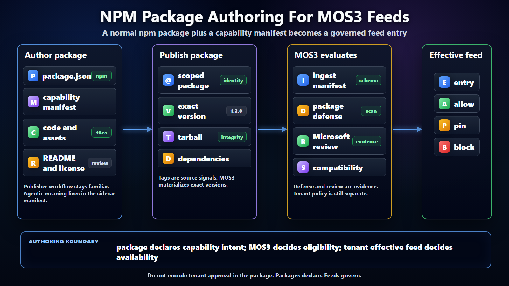

# MOS3 NPM Package Authoring



## Purpose

This note defines the authoring convention behind the feeds position that
skills and plugins should be npm packages by default. The goal is to keep
publisher workflow boring while giving MOS3, tenant admins, and clients enough
metadata to govern, install, explain, and revoke packages safely.

## Position

A shareable skill or plugin should be an ordinary npm package plus a capability
manifest. npm supplies the package coordinate, version, tarball, dependency
closure, registry metadata, integrity, provenance signals, and publishing
workflow. The capability manifest supplies the agentic meaning that npm does
not know: kind, entry point, permissions, runtime requirements, auth
requirements, data boundaries, compatible surfaces, and policy hints.

MOS3 should ingest the package and the manifest together. The feed entry should
then reference the exact npm package version and integrity while carrying MOS3
review, package defense, tenant policy, scope, and client-visible outcome.

The current Scout feed stack proves the feed and projection side first. MOS3
catalog exports and live acquisitions can already be normalized into Scout feed
documents, and Lobster can host tenant-approved and personal feed projections.
The authoring convention in this note is the next package-supply step: it
defines how a skill or plugin becomes a high-quality source package that MOS3
can ingest into those feeds.

## Package Contents

The package should look familiar to any JavaScript or TypeScript publisher.
It should have a normal `package.json`, normal source or built output, a
license, repository metadata where available, a README, and a constrained
`files` list so the tarball contains only intentional content.

The package should also include a sidecar capability manifest. The preferred
filename for the first pass is `mos3.capability.json`. A namespaced
`package.json` field can point to it, but the manifest should remain a separate
file so it can evolve without overloading generic npm metadata.

The manifest should name the capability kind, package entry point, supported
surfaces, supported runtimes, session lifetime, required permissions, auth
model, data access boundary, configuration needs, and any declared MCP,
connector, or tool interfaces. It should not try to encode tenant policy.
Tenant policy belongs in MOS3 effective feeds.

## Authoring Flow

The authoring flow should stay simple:

```text
Author package
  normal npm package plus mos3.capability.json

Publish package
  npm-compatible registry with exact version and integrity

Ingest package
  MOS3 reads package.json, tarball metadata, and capability manifest

Evaluate package
  package defense, Microsoft review, compatibility checks

Materialize feed
  exact package reference plus policy outcome in tenant effective feed
```

This preserves developer workflow. It also avoids making every client parse
publisher-specific metadata or discover random npm packages directly.

## Naming And Scope

Package names should be scoped. The scope is part of the trust story, not just
a naming convention. Examples include `@clawhub/skill-excel-review`,
`@microsoft-scout/plugin-tenant-audit`, and
`@contoso-scout/skill-quarterly-close`.

The package name should describe the shareable capability, not the internal
implementation repo. Renaming a package should be treated as a new package
identity unless MOS3 has an explicit migration record. Display names can change
more freely because MOS3 can preserve stable feed identity separately from UI
text.

Versions should be exact. MOS3 can observe source tags such as `latest`,
`beta`, or `candidate`, but the tenant effective feed should materialize a
specific package version. Clients should install that version and verify the
integrity referenced by MOS3.

## Manifest Responsibilities

The capability manifest should be intentionally small at first. It should
answer what the package is, where the client starts, what runtime it expects,
what it can touch, and which surfaces it claims to support.

It should not duplicate everything in `package.json`. The package name,
version, license, repository, dependency list, and tarball are npm concerns.
The manifest should reference those indirectly through the package coordinate.

It should not contain tenant allowlists, group scope, device scope, or final
approval state. Those are effective feed decisions. A package can declare that
it supports Scout and VS Code, but it cannot declare that a tenant has approved
it for Scout and VS Code.

## Package Defense Inputs

Authoring should make package defense easy. Packages should publish from
trusted build workflows where possible, include provenance where available,
minimize tarball contents, avoid generated secrets or local artifacts, and keep
dependencies explicit.

MOS3 package defense should evaluate the exact tarball and dependency closure
that the feed will approve. It should not merely scan a source repository or a
mutable npm tag. Defense evidence should attach to a specific package name,
version, registry, tarball, integrity value, and scan revision.

If a package changes dependencies, publisher, registry, provenance posture, or
manifest permissions, MOS3 should be able to require recheck before that new
version becomes eligible for tenant approval.

## Client Responsibilities

Clients should treat the package as an acquisition target, not as the policy
source. The client receives the effective feed entry, verifies the feed, fetches
the exact npm package reference, verifies package integrity where possible, and
then hands activation to the local runtime.

Clients should not resolve mutable npm tags during governed install. They
should not use public npm search as enterprise-approved discovery. They should
not silently upgrade beyond the version selected by MOS3. If the package
defense state is quarantined or failed, the client should block new install
unless the feed carries an explicit exception outcome.

## Open Questions

The first open question is whether MOS3 should require `mos3.capability.json`
for all shared skills and plugins, or allow a namespaced `package.json` summary
for lightweight entries. The recommendation is sidecar required, summary
optional.

The second open question is whether Microsoft should define one blessed npm
scope for curated packages or support many allowlisted scopes from day one.
The recommendation is many allowlisted scopes, with Microsoft curated feeds
recording which scopes have passed review.

The third open question is whether dependency closures should be locked by the
package author, MOS3, or the client. The recommendation is that MOS3 records the
resolved dependency and package defense evidence used for the approved version,
while clients install from the effective feed rather than resolving broad
publisher intent.

## Recommended Next Step

Define the first `mos3.capability.json` draft with only the minimum fields
needed for a demo: kind, entry point, surfaces, runtimes, session scope,
permissions, auth model, and data boundary. Use one ClawHub npm package as the
sample, ingest it into MOS3, run package defense, approve it for a tenant, and
install it from the tenant effective feed. The feed side of that demo should
reuse the existing Scout `FeedDocument` contract and, once #3236 lands, the
hosted `/v1/scout/feeds/approved.json` route. User-authored package visibility
should use the personal projection model from #3238 rather than exporting local
folders directly.
