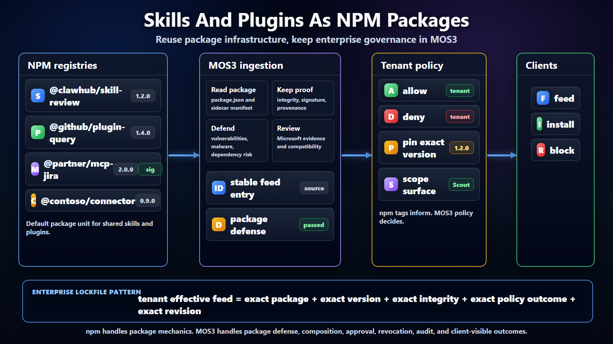

# MOS3 Feed NPM Leverage



## Purpose

This note answers how MOS3 feeds can take advantage of npm instead of
inventing a new artifact and package distribution stack. The recommendation is
to make skills and plugins npm packages by default, using npm-compatible
registries for package identity, versioned artifacts, tarball integrity,
provenance, and installer familiarity, while keeping MOS3 as the enterprise
registry, curation, policy, and feed composition plane.

## Core Position

npm should be treated as the default package substrate for skills and plugins,
not the enterprise governance model. A skill or plugin should usually be
published as an npm package with a scoped name, semantic version, tarball,
integrity metadata, provenance where available, and optional distribution tags.
MOS3 should ingest those package records and convert them into governed feed
entries. Tenant admins should never have to trust npm tags or package
visibility alone as the enterprise control point. They should trust MOS3
effective feeds, which can point back to npm packages while adding Microsoft
review, tenant allow and deny state, pins, scopes, revocation, audit, and
client compatibility.

This lets us reuse the parts of npm that already work well while avoiding the
mistake of making every client become an npm governance client.

The three-layer distinction should stay explicit:

```text
npm = package identity, version, artifact, and integrity substrate
MOS3 = registry, metadata, acquisition, admin, review, and policy authority
feeds = signed effective views that clients consume
```

That means MOS3 can keep existing metadata and manual settings while feeds
project the effective outcome of those settings into Scout, Chat/Cowork,
VS Code/GitHub Copilot, OpenClaw, and other clients.

## Current Stack Alignment

The Lobster feed stack has not yet made npm the only artifact path. It first
proved the governance and feed boundary:

- #3170 imports MOS3 catalog export data into Scout feeds.
- #3221 imports live MOS3 acquisitions into Scout feeds.
- #3236 hosts a signed tenant-approved feed projection for clients.
- #3238 adds a signed personal feed projection for a caller.

Those PRs establish where npm-backed package coordinates should land: inside
the feed entry's package or install metadata, after MOS3 import and before
client acquisition. The next npm-specific slice should add an npm-backed source
adapter or package authoring convention, not change the feed hosting boundary.

## Why NPM Is Useful Here

npm already gives the ecosystem a familiar package coordinate: package name,
scope, version, registry, and tarball URL. That maps naturally to feed entries.
For example, a ClawHub package might use `@clawhub/skill-excel-review`, a
Microsoft curated adapter might use `@microsoft-scout/connector-sharepoint`,
and a team package might use `@contoso-scout/skill-quarterly-close`.

npm also gives us strong operational habits. Versions are immutable once
published to a registry. Dist-tags can label publisher intent such as `latest`,
`beta`, `reviewed`, or `candidate`. Lockfiles show how exact package trees are
made reproducible. Registry metadata carries tarball integrity. Modern npm
supports registry signatures, provenance, audit, trusted publishing, and staged
publishing in supported flows. These are valuable building blocks for an
enterprise feed story.

The important distinction is that these primitives are publisher-side or
installer-side mechanisms. They do not answer tenant policy questions by
themselves. A package can be valid, signed, and current, but still not approved
for a tenant, surface, group, device class, environment, or runtime. MOS3
should add that decision layer.

## Do We Need An NPM Defender?

We need the function, but we should be careful with the name. "npm Defender"
could sound like a new standalone product. The architecture needs package
defense for npm-backed skills and plugins, and that defense can be implemented
through existing Microsoft security services, GitHub security signals, npm
signals, internal scanners, or MOS3 review services.

Package defense should answer whether an exact npm package version is eligible
for curation. It should evaluate publisher trust, registry trust, package
integrity, provenance, dependency risk, known vulnerabilities, malware signals,
unexpected dependency expansion, stale scans, source revocation, and exception
state. The output should be evidence plus an outcome: passed, warning,
quarantined, failed, or recheck required.

This defense layer should sit before tenant approval. A package can be validly
published and still be quarantined. A package can pass defense and still require
Microsoft review. A package can pass Microsoft review and still be denied by a
tenant. Keeping those decisions separate is what makes the model explainable.

The practical term for now should be "package defense" or "npm package defense"
rather than "npm Defender." If the implementation later maps directly to
Microsoft Defender, that branding can be added without changing the feed model.

## The Additive Model

The additive model is source package first, MOS3 feed second, client install
third.

Publishers use npm-compatible registries to publish packages. Those registries
could include public npm, GitHub Packages, Azure Artifacts, private enterprise
registries, or a ClawHub registry that exposes an npm-compatible surface.

MOS3 ingests package metadata from those registries and from any richer source
catalog around them. It records the package coordinate, tarball integrity,
source registry, source revision, publisher identity, package manifest,
provenance status, package defense state, review evidence, compatibility
claims, and deprecation or revocation signals.

Tenant admins then curate. They decide which packages are allowed, denied,
pinned, scoped, deprecated, or revoked. MOS3 materializes a tenant effective
feed that includes the package coordinate and integrity details clients need,
plus the enterprise decision clients must follow.

Clients consume the MOS3 effective feed. A client may use npm tooling,
package-manager libraries, or registry APIs to acquire the artifact, but it
does not independently discover random package supply as approved enterprise
supply. The client installs only what the effective feed permits.

## What We Should Reuse Directly

We should reuse npm package coordinates. Feed entries should carry the package
name, version, registry URL, tarball URL, and integrity field. This gives
clients a familiar acquisition target and gives admins a stable artifact
reference.

We should reuse semantic versioning and immutable package versions. MOS3 pins
should point to exact versions. MOS3 update suggestions can compare source
versions, Microsoft curated versions, and tenant pinned versions without
inventing a new version language.

We should reuse dist-tags as source channel signals. Dist-tags are useful for
publisher intent, but not for tenant control. A source can tag a version as
`latest` or `candidate`; MOS3 can decide whether that version becomes eligible,
reviewed, or approved. Tenant effective feeds should not depend on mutable tags
at install time. They should materialize exact package versions.

We should reuse npm integrity, signatures, provenance, audit, and staged
publishing signals where available. These signals should enrich MOS3 package
defense, review, and risk evidence. They should not automatically imply
enterprise approval.

We should reuse lockfile ideas. The tenant effective feed should behave like an
enterprise lockfile for agentic capabilities: exact package versions, exact
source, exact integrity, exact policy outcome, and exact feed revision. That
lets clients refresh predictably and lets admins roll back or explain changes.

## What MOS3 Still Owns

MOS3 owns source normalization. A package manifest is not enough to describe a
skill, plugin, MCP server, connector, agent, runtime requirement, auth
requirement, data boundary, client compatibility, or policy posture. MOS3
should normalize those into a feed entry contract.

MOS3 owns curation and governance. Microsoft review, tenant allow and deny,
version pinning, group and surface scope, revocation, deprecation, audit, and
explainability belong in MOS3. npm can host an artifact, but MOS3 decides
whether that artifact is visible or installable in the enterprise.

MOS3 owns the package defense decision boundary. It can call out to existing
security systems, but the effective feed must carry the resulting state and
client outcome. Clients should not independently decide that a package is safe
because npm install succeeds or because a registry tag exists.

MOS3 owns effective feed materialization. Clients should receive exact approved
entries, not open-ended registry queries. The feed should say which package
version is approved, where to fetch it, how to verify it, what client surfaces
can show it, and what outcome to apply if the package is revoked or stale.

MOS3 owns cross-source composition. npm can be one source substrate, but it will
not be the only one. ClawHub, MOS3 public catalog, partner catalogs, internal
catalogs, connectors, and team feeds may all contribute. MOS3 should compose
them into one governed tenant view.

## Package Shape

The minimal package shape should be boring. Use normal `package.json` fields
for name, version, description, license, repository, files, dependencies, and
publish configuration. Add capability metadata in one of two ways.

The first option is a namespaced `package.json` field such as `mos3` or
`openclaw`. This is easiest for small packages and simple tooling. The second
option is a sidecar manifest inside the package, such as `mos3.skill.json`,
`mos3.plugin.json`, or `mos3.capability.json`. This is better when the metadata
is large, signed independently, or shared across packaging formats.

For the first implementation, the sidecar is cleaner. It keeps npm packaging
standard and lets MOS3 evolve the capability contract without overloading
generic package metadata.

The companion note `mos3-feed-npm-authoring.md` defines the first authoring
convention: normal npm package, `mos3.capability.json` sidecar, package defense
evidence, and MOS3 effective feed output.

## Source Feeds Versus Tenant Feeds

An npm registry can be a source feed, or it can back a source feed. A source
feed might say, "here are all packages under `@clawhub` that claim to be
skills." MOS3 then evaluates those packages and publishes a tenant effective
feed that says, "for this tenant, this exact package version is allowed for
Scout and VS Code, this version is pinned, this package is blocked, and this
other package is hidden because it is out of scope."

That distinction is what prevents registry sprawl from becoming client sprawl.
Different ecosystems can keep their publishing workflows. MOS3 still gives
tenants one control plane.

## Recommended MVP

The feed MVP is already in motion through MOS3 import, live acquisition import,
hosted tenant-approved serving, and personal projection. The npm-specific MVP
should now add one npm-backed source adapter to MOS3 feed composition. The
adapter reads an allowlisted npm scope or registry, resolves package metadata,
extracts the sidecar capability manifest, records tarball integrity and
provenance signals, runs or imports package defense evidence, and emits
normalized MOS3 source feed entries.

Then MOS3 should materialize one tenant effective feed from that source. The
feed should contain exact package coordinates, exact versions, tarball
integrity, package defense state, review state, tenant policy outcome, scope,
compatibility, and revision. Scout or OpenClaw can consume that effective feed
and install only the approved exact packages.

The first demo should show a ClawHub package published to an npm-compatible
registry, ingested by MOS3, approved by a tenant admin, pinned to an exact
version, and installed by a client from the MOS3 effective feed. A second step
should show the source publishing a new version, MOS3 detecting it, the admin
previewing impact, and the client receiving an update only after the tenant
effective feed revision changes.

## Open Questions

Should Microsoft host a dedicated npm-compatible registry for curated skills
and plugins, or should MOS3 support multiple upstream registries with tenant
registry allowlists?

Should capability metadata live in a sidecar manifest only, or should a small
summary also appear in `package.json` for search and discovery?

Should MOS3 publish tenant effective feeds as a custom feed document that
references npm artifacts, or as an npm package that contains the effective feed
document? The first is cleaner for clients. The second may be useful for
offline mirroring and audit snapshots.

How much of npm staged publishing and trusted publishing should be required for
Microsoft curated feeds, compared with optional evidence for community or team
feeds?

## Bottom Line

Use npm by default for skill and plugin packaging so Microsoft does not invent
packaging, versioning, artifact storage, integrity, and publisher workflow. Do
not use npm as the tenant governance model. MOS3 should ingest npm-backed
package supply and publish tenant effective feeds that are exact, auditable,
policy-aware, and client-consumable.

## References

- [npm package.json](https://docs.npmjs.com/files/package.json/)
- [npm publish](https://docs.npmjs.com/cli/commands/npm-publish/)
- [npm dist-tags](https://docs.npmjs.com/adding-dist-tags-to-packages/)
- [npm install and lockfiles](https://docs.npmjs.com/cli/v11/commands/npm-install/)
- [npm provenance](https://docs.npmjs.com/generating-provenance-statements/)
- [npm registry signatures](https://docs.npmjs.com/about-registry-signatures/)
- [npm staged publishing](https://docs.npmjs.com/staged-publishing/)
