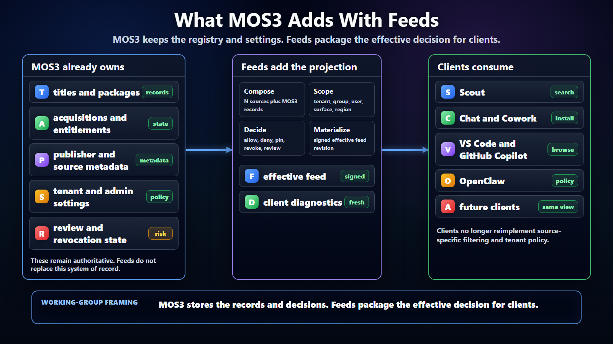

# MOS3 Feeds Working Group Brief



## Short Version

MOS3 already has the important foundation: metadata, package/title records,
acquisitions, assignments, publisher/source data, and user or admin settings.
Feeds do not replace that foundation. Feeds add a signed, scoped, materialized
projection of the effective decision so clients can consistently answer:
"what can this caller discover or install now?"

This should also not be read as a replacement for DV or any existing artifact
authority. MOS3 continues to own the records, artifact references, acquisition
state, assignment state, and policy decisions. The feed is the client-facing
projection of those decisions, not the write path or the authorization source.

## The Clarification

The feed proposal is not asking MOS3 to become a second package registry or to
move policy out of MOS3. MOS3 remains the system of record for metadata,
governance, entitlement, acquisition, assignment, authoring, and admin state.
The feed is the distribution view that packages those records and decisions for
clients.

Without feeds, every client has to combine raw MOS3 records, ClawHub or other
source catalogs, admin settings, group scope, review state, package defense,
revocation, pins, and compatibility rules on its own. That creates drift. Scout,
Chat/Cowork, VS Code/GitHub Copilot, OpenClaw, and future clients can all show
slightly different answers for the same tenant.

With feeds, MOS3 composes the effective view once and clients consume that view.
The source of truth remains MOS3. The feed is the cacheable, attestable,
diagnosable client contract.

```text
Existing MOS3:
  records, metadata, acquisitions, assignments, admin settings, APIs

Feeds add:
  signed effective views, source composition, tenant/user scope, pins,
  denials, revocations, package-defense outcomes, client diagnostics

Client result:
  one governed discovery/install contract across many surfaces
```

## What MOS3 Already Has

MOS3 already has or is expected to have the hard internal state:

- package, title, skill, connector, agent, and publisher metadata;
- user acquisitions and entitlements;
- tenant and admin assignments;
- source and partner metadata;
- policy and visibility settings;
- APIs for authoring, acquisition, management, and lookup.

Those remain authoritative. The feed layer should be generated from them, not
separate from them.

## RBAC Question To Validate

The proposal assumes MOS3 can distinguish the actor who reads an effective
feed from the actor who authors, curates, approves, administers, or audits the
underlying records. That may already exist through MOS3 acquisitions,
assignments, package ownership, admin center permissions, service principals,
or registry ACLs. We should not assume the exact mapping.

The working model needs at least these personas:

- **Client reader:** fetches a tenant or personal effective feed for the
  authenticated caller.
- **Personal publisher:** publishes or updates packages the user owns or has
  acquired rights to publish.
- **Package/source owner:** owns package metadata, source feed registration, or
  publisher records.
- **Microsoft curator:** attaches Microsoft review, package defense, and
  curated baseline decisions.
- **Tenant admin:** allows, denies, pins, scopes, revokes, and publishes the
  tenant effective view.
- **Operator or auditor:** inspects feed revisions, policy reasons, refresh
  state, drift, and audit trails without becoming a policy owner.

The near-term ask for MOS3 is to map these personas to concrete RBAC constructs
that exist today, identify gaps, and decide which actions are feed-generation
actions versus underlying MOS3 registry or artifact actions.

## What Feeds Add

Feeds add the missing distribution contract:

- **Composition over N sources:** ClawHub, MOS3 public catalog, GitHub Copilot
  marketplace, partner catalogs, internal catalogs, team feeds, and future
  private sources can all flow into one effective view.
- **Tenant effective view:** admins can allow, deny, pin, scope, and revoke
  entries, then preview the exact feed clients will use.
- **User personal view:** a signed personal feed can represent packages a user
  authored, acquired, or has access to, without making every local folder an
  unmanaged enterprise source.
- **Client consistency:** clients search the same effective feed instead of
  each implementing source-specific policy filtering.
- **Operational safety:** feeds carry revision, freshness, source provenance,
  attestation, and diagnostics so stale or inconsistent clients can be
  explained.
- **Package defense output:** package integrity, provenance, vulnerability,
  malware, publisher-risk, and review outcomes can be surfaced separately from
  tenant approval.

## Concrete Example

A ClawHub plugin can remain published in ClawHub and packaged through npm. MOS3
imports the ClawHub feed, normalizes the entry, records package provenance and
package defense state, attaches Microsoft review state, and lets a tenant admin
approve version `1.4.2` for Scout and VS Code while denying version `1.5.0` or
blocking one MCP tool. The tenant effective feed then tells clients exactly
what is searchable and installable.

The client does not need to know how to query ClawHub, npm, MOS3 acquisitions,
admin assignments, and policy sources independently. It reads the effective
feed and preserves provenance for diagnostics and audit.

## Boundary

Feeds are for governed discovery, install eligibility, update visibility,
revocation visibility, and client diagnostics. They are not the only MOS3 API.
MOS3 can still use richer APIs for authoring, upload, purchase, acquisition,
assignment, admin management, and live record mutation.

The feed should be treated as the compact answer produced by those systems:

```text
MOS3 record state + source catalogs + admin policy + review evidence
  -> feed composition
  -> effective client view
```

## Working Group Decision

The decision is whether MOS3 owns only the underlying registry records, or owns
the registry plus the feed composition projection. The recommendation is MOS3
owns both. Registry ownership without composition leaves each client to
recreate tenant policy. Composition ownership gives clients one governed
contract while keeping MOS3 authoritative for the underlying records and
settings.
