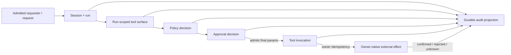

# Authorized External-Action Evidence Slice

## Status

- Phase: Frame + narrow source audit
- Priority: 2
- Enterprise movement: tool/external-action and policy/approval relationships
  from fragmented C2 evidence toward one bounded C3 proof
- Audited OpenClaw worktree:
  `C:\src\openclaw-design-audit`
- Audited commit:
  `bde1602e6e86fd91dd0bec3aae714e059e556c4d`

## Thesis

One approved, idempotent external action can correlate its admitted requester,
run-scoped tool surface, policy/approval decision, invocation, effect identity,
and terminal certainty without moving authorization or execution into the
audit owner.

The slice should extend the existing trusted tool lifecycle and durable audit
projection. It should not introduce a universal action bus.

## Problem and Affected Users

OpenClaw already has strong but separate facts:

- run/session/tool-call identity;
- ordered `before_tool_call` policy and approval;
- owner-specific idempotency;
- tool lifecycle diagnostics;
- durable metadata-only audit; and
- owner-specific results.

The current durable record can prove that a tool call started and finished. It
cannot prove which policy/approval decision admitted the final execution
parameters or whether a successful tool result corresponds to one confirmed
external effect.

Affected users:

- security teams investigating privileged actions;
- operators diagnosing duplicate or uncertain effects;
- compliance teams reconstructing approval;
- tool/plugin authors declaring retry and effect semantics; and
- users reviewing why an action was allowed or blocked.

## Working Owners

| Object | Current owner |
| ------ | ------------- |
| Inbound requester/admission | Channel/Gateway ingress owner |
| Session and run identity | Session and agent-run owners |
| Tool definition and run-scoped surface | Tool catalog/materialization owners |
| Ordered tool policy | `before_tool_call` policy chain and trusted policy owners |
| Approval request/decision | Plugin, exec, voice, or other approval owner |
| Effective execution parameters | Tool adapter and semantic tool owner |
| Idempotency/effect identity | Semantic external-action owner |
| Tool lifecycle event | Tool runtime/diagnostic owner |
| Durable audit record | Gateway audit projection/store |

Audit may project these owner facts. It must not decide authorization, mutate
execution parameters, or claim an external effect the semantic owner cannot
confirm.

## Current Source Facts

### Ordered policy and approval

`src/agents/agent-tools.before-tool-call.policy.ts` evaluates a concrete tool
call through an ordered policy chain. It carries:

- tool name and call ID;
- run/session/agent context;
- requester and originating turn context;
- derived host paths and tool identity;
- trusted policy results;
- plugin hook results;
- approval requirements; and
- final adjusted parameters.

Trusted policy veto and normal hook veto are distinct blocked outcomes.
Failures in the policy chain fail closed.

`src/agents/agent-tools.before-tool-call.approval.ts`:

- snapshots mutable tool parameters before an approval may outlive the policy
  pass;
- supports request, report, deny, and deferred modes;
- reports allow-once, allow-always, deny, cancel, timeout, and unavailable
  outcomes through the owner-specific approval transport; and
- returns an `approvalResolution` with allowed parameters.

The generic `HookOutcome` in
`src/agents/agent-tools.before-tool-call.types.ts` does not carry:

- approval request ID;
- decision time or expiry;
- policy/approval generation;
- approving principal/device;
- target/authority scope; or
- a stable redacted decision reference.

### Approval-to-execution handoff gap

`src/agents/agent-tool-definition-adapter.ts` runs the policy chain, applies
adjusted parameters, performs final client voice confirmation, and invokes the
tool with the same `toolCallId`.

The adapter consumes `hookOutcome.params`, but the allowed
`hookOutcome.approvalResolution` is not attached to the invocation,
tool-lifecycle event, or durable audit record. The approval result therefore
does not survive the generic execution boundary as a portable correlation
fact.

This is the narrowest high-value seam for the slice.

### Richer exec approval precedent

`src/agents/bash-tools.exec-approval-request.ts` already demonstrates a more
complete owner-shaped request:

- approval ID and expiry;
- command or system-run plan;
- gateway/node target;
- security and ask mode;
- agent/session/run/tool-call identity;
- resolved path;
- originating channel/account/thread;
- eligible reviewer device IDs; and
- two-phase registration before waiting, preventing approval races.

This precedent should inform the experimental correlation fields. It must not
be flattened into the generic plugin approval type because exec approval owns
command- and target-specific semantics.

### Tool-specific idempotency

Retry/effect safety is intentionally owner-specific:

- `src/agents/tool-replay-safety.ts` permits blind replay only for an audited
  set of non-mutating core tool instances and fails closed for shadowed names;
- `src/agents/tools/computer-tool.ts` derives `computer.act` idempotency from
  the concrete tool call and configured scope;
- `src/agents/tools/message-tool.ts` creates and reuses delivery keys according
  to message-action outcome; and
- node tools often create a fresh invocation key for each action.

These behaviors correctly reject one universal replay rule. The evidence
contract should carry the semantic owner's declaration and result, not infer
effect uniqueness from tool-call or transcript identity.

### Trusted tool lifecycle

`src/infra/diagnostic-events.ts` defines trusted tool execution events with:

- run/session/agent;
- source timestamp;
- tool name/source/owner;
- tool call ID;
- parameter shape summary;
- deterministic mutation classification; and
- started, completed, blocked, error, cancellation, timeout, or unknown
  terminal facts.

The trusted event does not currently carry:

- admitted requester identity;
- accepted configuration/tool-surface generation;
- policy or approval reference/generation;
- credential/profile reference;
- target endpoint class;
- idempotency/effect identity;
- dispatch settlement; or
- external-effect certainty.

### Durable audit

`src/audit/agent-event-audit.ts` projects trusted run and tool lifecycle events
into redaction-safe audit metadata:

- agent/session/run attribution;
- hashed provider-owned tool-call ID;
- normalized tool name;
- started/finished action;
- succeeded, blocked, failed, cancelled, timed-out, or unknown status; and
- stable source replay identity.

`src/audit/audit-event-types.ts` keeps this schema narrow and metadata-only.

This is a strong projection boundary. Its current `succeeded` status means the
tool runtime completed successfully. It does not mean:

- an approval was current at dispatch;
- one external effect occurred;
- a retry was deduplicated;
- a remote target settled;
- cancellation stopped a remote effect; or
- the admitted human requester can be reconstructed.

## Owner Relationship



No arrow permits Audit to mutate its source owner.

## Bounded V1 Slice

### Included

- one admitted local test requester;
- one session/run/tool-call;
- one mock external-action tool instance;
- one immutable run-scoped tool-surface fingerprint;
- one policy generation;
- one approval request/decision reference;
- one redacted target class;
- one owner-defined idempotency key;
- one owner-native effect ID and certainty;
- one successful replay proving no duplicate effect; and
- one fenced policy-generation failure with no effect.

### Excluded

- a universal principal model;
- real credentials or secret values;
- arbitrary shell execution;
- payment or production systems;
- every plugin approval transport;
- universal tool result/error types;
- centralized tool execution;
- transcript text as evidence; and
- an inference that all successful tools have external effects.

## Proposed Correlation Envelope

The envelope is attached after policy/approval and consumed by trusted
diagnostics/audit. It is not passed to the model and does not replace the
semantic tool input.

```json
{
  "operationId": "action-...",
  "request": {
    "admissionId": "request-...",
    "requesterRef": "sha256:...",
    "sessionId": "session-...",
    "runId": "run-..."
  },
  "capability": {
    "toolCallId": "sha256:...",
    "toolName": "mock_external_write",
    "toolOwner": "fixture",
    "surfaceGeneration": "sha256:..."
  },
  "authority": {
    "policyGeneration": "policy-7",
    "decision": "allow",
    "approvalRef": "sha256:...",
    "approvalResolution": "allow_once",
    "expiresAt": "2026-08-01T20:45:00Z"
  },
  "target": {
    "class": "test-ledger",
    "credentialRef": "fixture-profile"
  },
  "invocation": {
    "idempotencyKey": "sha256:..."
  }
}
```

Raw requester IDs, approval IDs, credential material, command text, tool
parameters, and effect content remain outside the durable projection.

## Accepted Result

```json
{
  "schemaVersion": 1,
  "evidenceType": "external_action.lifecycle",
  "operationId": "action-...",
  "result": "complete",
  "certainty": "confirmed",
  "authority": {
    "policyGeneration": "policy-7",
    "approvalResolution": "allow_once"
  },
  "invocation": {
    "toolCallId": "sha256:...",
    "idempotencyKey": "sha256:..."
  },
  "effect": {
    "owner": "fixture",
    "effectId": "sha256:...",
    "result": "applied",
    "duplicate": false,
    "certainty": "confirmed"
  }
}
```

Replaying the same invocation key returns the same effect ID with
`duplicate: true` and does not increment the fixture's effect count.

## Structured Failure

After approval but before dispatch, replace `policy-7` with `policy-8`.

Expected result:

```json
{
  "result": "blocked",
  "reason": "policy_generation_changed",
  "certainty": "confirmed",
  "authority": {
    "approvedPolicyGeneration": "policy-7",
    "currentPolicyGeneration": "policy-8"
  },
  "effect": {
    "result": "not_dispatched",
    "certainty": "confirmed"
  }
}
```

The fixture must prove the external-effect count remains zero. A later test may
cover dispatch uncertainty, which must produce `unknown`, not success or
failure-shaped certainty.

## Evidence Header Experiment

This slice exercises the same candidate header as memory lifecycle:

- evidence type/schema version;
- owner/subject identity;
- owner generation;
- operation/attempt identity;
- observed/effective time;
- policy/config/authority generation;
- result and structured reason;
- certainty/freshness;
- redaction/classification;
- integrity reference; and
- owner-native evidence links.

Unlike memory, this slice requires a separate `effect.certainty` from tool
runtime status. If the shared header cannot preserve that distinction, it
should remain facility-specific.

## Role Findings

### Tool/runtime owner

Keep parameter shaping, idempotency, dispatch, result semantics, and effect
certainty with the semantic tool. The generic adapter may carry correlation
metadata but cannot infer effect identity.

### CISO/compliance

Persist the authority decision used at execution time, not current policy.
Hash provider-controlled IDs and exclude tool parameters, credentials, and
effect content from ordinary audit.

### Platform/operator

Correlate request, run, tool call, approval, invocation, and effect while
retaining `blocked`, `unknown`, cancelled, timed-out, and failed distinctions.
Do not equate local cancellation with remote settlement.

### Founder/new hire

Keep the user experience as one approval and one result. Detailed evidence is
an operator projection, not another interaction step or global workflow
engine.

## Deletion Target

Remove or prohibit:

- audit reconstruction from current config or current policy;
- transcript parsing to guess authorization;
- success claims based only on a generic tool result;
- using transcript projection keys as side-effect identity;
- generic retries of mutating tools without owner declaration; and
- logging raw credentials, parameters, approval text, or effect content.

## Disproof Conditions

Stop or narrow the slice if:

- approval correlation requires secret values;
- policy generation cannot be checked without re-deciding authorization in
  audit code;
- the mock owner cannot distinguish runtime completion from effect settlement;
- replay deduplication requires the transcript projector to own the effect; or
- adding correlation forces every tool into one result or idempotency model.

## Cheapest Proof

1. Register a test-only `mock_external_write` tool with an in-memory effect
   ledger keyed by owner-defined idempotency key.
2. Admit one test requester and fingerprint the run-scoped tool surface.
3. Require an allow-once approval under `policy-7`.
4. Change to `policy-8` before dispatch and prove a blocked result with zero
   effects.
5. Repeat under a stable generation and prove one confirmed effect.
6. Replay the same invocation key and prove the same effect ID and no second
   effect.
7. Read the durable audit/evidence projection and verify it contains no tool
   parameters, requester plaintext, approval text, credentials, or effect
   content.

This should begin as a fork-only conformance test around the existing trusted
tool lifecycle and audit writer. No universal action API is justified.
