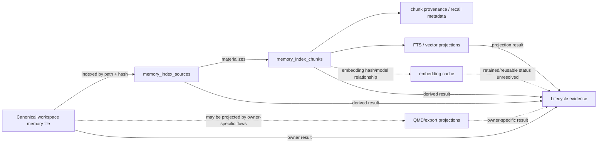

# Memory Corpus Lifecycle Evidence Slice

## Status

- Phase: Frame + narrow source audit
- Priority: 1
- Enterprise movement: memory `E4/C1` toward a reusable C2 owner contract
- Audited OpenClaw worktree:
  `C:\src\openclaw-design-audit`
- Audited commit:
  `bde1602e6e86fd91dd0bec3aae714e059e556c4d`

## Thesis

The file-backed memory owner can report deletion of one canonical workspace
memory document and cleanup of its local derived search state without moving
memory ownership into a privacy service.

The first slice should target the current `memory-core` file/index relationship,
not attempt to unify every memory plugin:

```text
workspace memory file
-> memory-core source record
-> chunks + provenance/recall metadata
-> FTS/vector search projections
-> lifecycle evidence
```

`memory-lancedb` remains a separate canonical memory owner with its own
entry-ID deletion semantics.

## Problem and Affected Users

OpenClaw can remove current memory data, but completion is owner-local and
mostly inferred:

- file-backed memory index cleanup follows source absence during sync;
- LanceDB deletion reports one row as deleted/not found;
- QMD session-export cleanup is best effort;
- no shared operation correlates canonical removal, derived cleanup, retained
  exceptions, and evidence; and
- the `memory_forget` tool describes itself as GDPR-compliant even though its
  result proves only its LanceDB owner row.

Affected users:

- users asking OpenClaw to forget retained memory;
- operators diagnosing stale recall;
- privacy/compliance owners proving deletion;
- memory plugin authors; and
- hosts that currently infer completion from file or index state.

## Working Owners

| Object | Current owner |
| ------ | ------------- |
| `MEMORY.md`, `USER.md`, and `memory/*.md` | Workspace/file memory owner |
| `memory_index_sources` | Memory-core source index |
| `memory_index_chunks` | Memory-core chunk index |
| chunk provenance and recall metadata | Memory-core derived metadata owners |
| FTS and vector rows | Memory-core search projection owners |
| embedding cache | Memory-core embedding/cache owner |
| QMD exported Markdown and collection mappings | QMD session-export/projection owner |
| LanceDB memory row | `memory-lancedb` canonical store owner |
| Lifecycle request and aggregate evidence | Proposed coordinator/projection only |

The lifecycle coordinator must not write these stores directly.

## Current Source Facts

### File-backed canonical corpus

`packages/memory-host-sdk/src/host/internal.ts` discovers:

- root `MEMORY.md`;
- root `USER.md`;
- Markdown and enabled multimodal files under `memory/`; and
- configured extra paths.

`extensions/memory-core/src/memory/memory-path-provenance.ts` classifies indexed
paths by origin (`owner`, `agent`, `untrusted`, or `system`). This provenance is
useful trust evidence, but it is not enterprise data classification,
retention, consent, or hold policy.

### Derived SQLite index

`packages/memory-host-sdk/src/host/memory-schema-base.ts` defines:

- `memory_index_sources`;
- `memory_index_chunks`;
- `memory_index_state`;
- `memory_embedding_cache`;
- vector state; and
- related FTS/provenance/recall metadata.

Source rows carry path, source family, content hash, mtime, and size. Chunks
carry path/source, line range, content hash, embedding model, indexed text,
embedding, and update time.

`memory_index_chunk_provenance` is keyed to chunk ID with `ON DELETE CASCADE`,
so deleting a chunk removes its provenance row.

### Stale-source cleanup

`extensions/memory-core/src/memory/manager-source-sync-ops.ts`:

1. lists current canonical memory files;
2. compares them with indexed source rows;
3. indexes changed files;
4. identifies source paths no longer active; and
5. deletes source, vector, chunk, and FTS rows for those paths.

The same pattern removes stale indexed session sources.

This is healthy owner-local convergence. It is not yet a lifecycle-operation
contract because:

- deletion is inferred from absence during sync;
- there is no delete request/operation ID;
- there is no canonical preimage generation in a result;
- there is no per-derived-owner settlement;
- FTS cleanup errors are ignored;
- the caller receives no complete/partial/blocked result; and
- there is no retained exception or policy/hold evidence.

### Reindex publication and fencing

`extensions/memory-core/src/memory/manager-db.ts` builds a shadow index and
publishes tables only if the live memory revision still equals the expected
revision. A concurrent memory change rejects stale publication.

This revision check is the correct analogue for lifecycle fencing: deletion
evidence must bind the canonical preimage and the index revision it cleaned.

### QMD exports

`extensions/memory-core/src/memory/qmd-session-exporter.ts` creates derived
session Markdown under an export directory and supports retention-days cutoff.
It removes files not in the current keep set, but stale-export removal failure
is logged at debug level and the export continues.

QMD export behavior proves why lifecycle evidence needs per-owner results:
canonical/session state can be current while a derived projection is deferred
or stale.

### LanceDB memory owner

`extensions/memory-lancedb/lancedb-store.ts` owns independent memory entries
identified by UUID and agent ID. `delete(agentId, id)`:

- validates ID format;
- scopes lookup and deletion to one agent;
- returns `false` when no row exists; and
- deletes the matching LanceDB row.

`extensions/memory-lancedb/index.ts` exposes `memory_forget`:

- exact ID deletion returns `deleted` or `not_found`;
- a high-confidence single search match can be deleted; and
- ambiguous matches are returned for caller selection.

The result proves only the LanceDB row outcome. The label "GDPR-compliant"
overstates the current contract because it does not prove:

- deletion from file-backed memory;
- transcript/session sources;
- QMD exports;
- backups/snapshots;
- provider-held data;
- legal-hold evaluation; or
- retained lifecycle evidence.

## Owner Relationship



The dotted relationships require explicit source verification per backend and
must not be assumed from the common word "memory."

## Bounded V1 Slice

### Included

- one `memory/<fixture>.md` canonical file;
- its `memory_index_sources` row;
- all matching chunk rows;
- matching vector and FTS rows;
- cascading chunk provenance/recall metadata;
- one delete operation identity;
- one expected canonical hash and index revision;
- one complete result; and
- one partial/blocked result.

### Excluded

- `MEMORY.md` semantic line-level editing;
- LanceDB row deletion;
- session transcript deletion;
- QMD session exports;
- backups and snapshots;
- remote embedding-provider retention;
- legal-hold implementation;
- enterprise policy storage; and
- a universal memory API.

These exclusions must appear as `not_applicable`, `not_in_scope`, or explicit
retained/external relationships rather than being silently counted as deleted.

## Proposed Operation

The operation is a coordinator around owner calls, not a new memory store.

### Input

```json
{
  "operationId": "memory-delete-...",
  "target": {
    "owner": "memory-core-file",
    "path": "memory/fixture.md",
    "expectedHash": "sha256:..."
  },
  "expectedIndexRevision": 42,
  "reason": "user_request"
}
```

### Owner steps

1. Resolve and contain the canonical workspace path.
2. Verify the expected canonical hash.
3. Remove the canonical file through the workspace/file owner.
4. Run targeted memory-core synchronization.
5. Verify the source row is absent.
6. Verify matching chunks, vector rows, FTS rows, and cascading metadata are
   absent.
7. Report embedding-cache relationship as removed, retained/reusable, or
   unknown after its owner contract is verified.
8. Retain a redacted result without memory content.

### Complete result

```json
{
  "schemaVersion": 1,
  "evidenceType": "memory.lifecycle",
  "operationId": "memory-delete-...",
  "subject": {
    "owner": "memory-core-file",
    "id": "memory/fixture.md",
    "generation": "sha256:..."
  },
  "ownerGeneration": {
    "beforeIndexRevision": 42,
    "afterIndexRevision": 43
  },
  "result": "complete",
  "certainty": "confirmed",
  "owners": [
    { "owner": "workspace-file", "result": "deleted" },
    { "owner": "memory-source-index", "result": "deleted" },
    { "owner": "memory-chunk-index", "result": "deleted" },
    { "owner": "memory-search-projections", "result": "deleted" }
  ],
  "retained": [],
  "contentRetained": false
}
```

### Structured failure

Use a generation conflict:

- the file changes after plan creation; or
- the memory index revision changes before cleanup commits.

Expected result:

```json
{
  "result": "blocked",
  "reason": "generation_changed",
  "certainty": "confirmed",
  "owners": [
    { "owner": "workspace-file", "result": "not_changed" },
    { "owner": "memory-index", "result": "not_changed" }
  ]
}
```

The first failure fixture should block before canonical deletion. A later
partial-result fixture may simulate derived cleanup failure after canonical
deletion, but V1 should first prove safe precondition fencing.

## Evidence Header Experiment

This slice exercises:

- `evidenceType`;
- `schemaVersion`;
- owner/subject identity;
- owner generation;
- operation identity;
- observed/effective time;
- result and structured reason;
- certainty/freshness;
- classification/redaction;
- integrity reference; and
- linked owner-native results.

Fields remain experimental until authorized-action and release-activation
slices prove the same header without semantic loss.

## Role Findings

### Memory/runtime owner

Keep file discovery, indexing, chunking, vector/FTS cleanup, and search with
memory-core. The lifecycle adapter may request and verify owner operations but
must not issue raw SQL against owner tables.

### CISO/compliance

Replace "GDPR-compliant" success language with exact owner scope. A complete
result must enumerate owners checked, retained exceptions, and evidence
integrity without retaining deleted content.

### Platform/operator

Expose `blocked`, `partial`, and `unknown`; do not turn stale or unavailable
derived owners into success. Evidence must be replayable for diagnosis without
rerunning deletion.

### Founder/new hire

Keep the ordinary user action simple ("forget this"), while advanced JSON
explains scope. Do not require enterprise policy configuration for local
file/index deletion.

## Deletion Target

Remove or prohibit:

- privacy/host code that infers complete memory deletion from file absence;
- audit reconstruction from current index state;
- generic "GDPR-compliant" claims for a single backend row; and
- direct cross-owner SQL cleanup outside memory-core.

## Disproof Conditions

Stop or narrow the slice if:

- memory-core cannot delete one file-derived index path without full reindex;
- proving cleanup requires retaining deleted content;
- embedding-cache ownership cannot be reported without claiming deletion;
- the adapter must bypass workspace containment or memory-core synchronization;
  or
- one result shape cannot distinguish blocked-before-delete from
  partial-after-delete.

## Cheapest Proof

1. Create `memory/lifecycle-fixture.md`.
2. Run memory-core sync and record source hash/index revision.
3. Preview deletion with expected hash/revision.
4. Change the file and prove `generation_changed` leaves file/index untouched.
5. Re-preview, delete, run targeted sync, and prove source/chunk/vector/FTS
   absence.
6. Emit redacted lifecycle evidence containing no memory text.

This can begin as a fork-only conformance harness around existing owner APIs.
No upstream API or RFC is justified until the result fields survive this proof.
