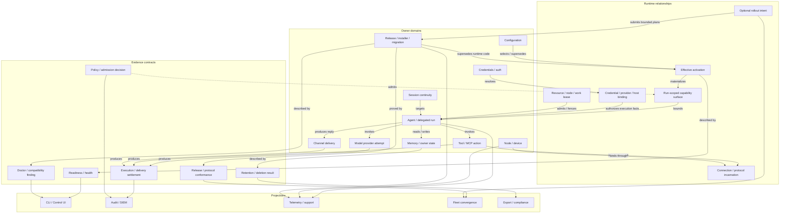

# OpenClaw Cross-Facility Relationship Model

## Purpose

This page connects the source-audited facilities without creating one universal
runtime object, event bus, identity type, or control plane.

The model answers:

- which owner objects relate across facilities;
- which generation or lease fences each relationship;
- where authority is checked;
- where effects and retained evidence diverge;
- which projections may be stale or partial; and
- which ownership collapses are explicitly rejected.

Facility specs and current source remain authoritative for owner-native
semantics.

## Frame

### Working owner systems

The stable architecture is the set of current owners:

- configuration and activation;
- credentials and auth profiles;
- sessions, runs, delegation, models, tools, channels, and nodes;
- workspace, state, memory, transcripts, and owner databases;
- package, release, service, and migration owners; and
- readiness, Doctor, audit, telemetry, privacy, resource, and fleet
  projections.

The missing shared capability is a small relationship vocabulary that lets
these owners exchange identity, generation, authority, outcome, and evidence
without translating their state into a central schema.

### Stop condition

Narrow or remove this model if it:

- cannot identify the real source owner for an edge;
- requires all facilities to implement a shared runtime base type;
- makes an evidence projection authoritative for mutation;
- erases owner-specific failure or settlement semantics; or
- turns optional enterprise administration into a local runtime dependency.

## Relationship Vocabulary

Relationships are descriptive contracts, not required TypeScript interfaces.

| Relationship | Meaning | Required facts |
| ------------ | ------- | -------------- |
| `declares` | A definition or manifest states a possibility. | owner, definition identity, version/generation |
| `selects` | Intent chooses a definition, route, policy, or target. | selecting owner, selection generation, selected identity |
| `resolves` | An owner converts a reference or intent into concrete facts. | input generation, resolved identity, provenance, outcome |
| `binds` | Two owner objects form a runtime relationship. | both identities, binding generation, renewal/loss semantics |
| `admits` | An authority permits, restricts, defers, or rejects an operation. | subject, authority/policy generation, decision, reason |
| `materializes` | Definitions and decisions become a bounded live surface. | activation/run generation, included/excluded facts |
| `invokes` | One owner requests bounded work from another. | operation identity, caller, target, deadline/idempotency |
| `produces` | An execution creates an outcome, state mutation, artifact, or effect. | execution identity, owner outcome, certainty |
| `projects` | A consumer-facing view renders owner facts. | subject/generation, source owner, freshness, redaction |
| `retains` | Evidence or state survives the producing execution. | retention owner, source generation, integrity, expiry |
| `fences` | A generation, lease, incarnation, or revocation invalidates stale work. | fenced identity, authority generation, rejection behavior |
| `revokes` | Authority or eligibility is removed without erasing history. | scope, generation, effective time, convergence evidence |
| `supersedes` | A newer accepted generation replaces an older one. | prior/current generations, activation boundary |
| `converges` | Desired and observed state are compared across targets. | desired identity, observed identity, evidence freshness, outcome |

## Four-Layer Graph



Dashed evidence relationships do not own the source object. Projections may
cache or aggregate evidence, but they cannot mutate the owner by changing the
projection.

## Relationship Families

### 1. Intent to activation

```text
definition
+ authored selection
+ policy/host inputs
-> candidate
-> validation/admission
-> accepted effective generation
-> live runtime surface
```

Participating owners:

- catalogs and manifests declare possibilities;
- configuration and policy express intent;
- resolvers bind concrete credentials, providers, paths, plugins, and hosts;
- activation owners accept, reject, hot-reload, or require restart; and
- readiness reports whether the accepted generation can serve.

Required fencing:

- source/config fingerprint;
- candidate transaction generation;
- accepted runtime generation;
- registry/plugin generation; and
- process or restart incarnation.

Rejected collapse:

- installed or selected does not mean active;
- active does not mean ready;
- readiness cannot change configuration; and
- catalog presence cannot grant authority.

### 2. Authority to runtime binding

```text
principal / device / service identity
+ credential or grant generation
+ policy and approval generation
+ endpoint / tenant / network scope
-> bounded runtime binding
```

Participating owners:

- credential references and auth profiles select material;
- issuer/provider owners refresh or revoke material;
- pairing owners issue device role grants;
- policy/approval owners decide authority;
- model, tool, channel, node, and host owners consume bindings.

Required fencing:

- principal or device identity;
- credential/profile generation;
- policy/approval generation;
- endpoint/account/tenant scope; and
- connection or prepared-runtime incarnation.

Rejected collapse:

- credentials are not correlation IDs;
- capability advertisement is not authorization;
- successful authentication is not policy approval; and
- a paired user device is not a host/workload identity.

### 3. Request to execution

```text
admitted request
+ continuity target
+ accepted activation
+ run-scoped capability surface
+ resource admission
-> run
-> ordered attempts
-> terminal owner outcomes
```

Participating owners:

- channel, CLI, schedule, or parent run owns ingress;
- session continuity owns the target generation;
- agent execution owns the run;
- delegation owns child control/completion relationships;
- provider, tool, node, and delivery owners own attempts;
- resource owners queue, throttle, reject, cancel, or kill.

Required fencing:

- idempotency key;
- session ID/generation;
- run ID and lifecycle generation;
- delegated child/controller identity;
- provider/tool/invocation attempt identity;
- resource lease; and
- cancellation/terminal settlement.

Rejected collapse:

- a session is not a run;
- lineage is not control authority;
- cancellation request is not proof remote effects stopped;
- transport reconnect does not authorize replay; and
- one generic `success` cannot represent provider, tool, delivery, and external
  effect settlement.

### 4. Execution to effect and delivery

```text
owner execution
-> local mutation or remote side effect
-> owner settlement
-> delivery attempt / receipt
-> retained transcript and audit projections
```

Participating owners:

- tool/MCP/node owners execute external actions;
- providers own model responses and usage;
- channels own native sends, retries, and receipts;
- transcript/session owners retain conversation evidence;
- audit/telemetry owners project bounded facts.

Required fencing:

- operation/invocation/tool-call identity;
- idempotency or replay declaration;
- connection incarnation where remote;
- delivery attempt identity;
- native provider receipt where available; and
- certainty: confirmed, failed, partial, cancelled, or unknown.

Rejected collapse:

- transcript projection is not side-effect identity;
- provider acceptance is not user-visible delivery;
- disconnect is not rollback;
- estimated usage cost is not invoice-grade chargeback; and
- ordinary telemetry is not automatically audit evidence.

### 5. Owner state to evidence

```text
owner state generation
-> bounded evaluation
-> condition / finding / lifecycle result / conformance result
-> retained evidence
-> role-specific projection
```

Participating owners:

- readiness evaluates current serviceability;
- Doctor explains and repairs with explicit effects;
- policy owners produce decisions;
- privacy owners coordinate export/delete/hold results;
- supply-chain and release owners retain provenance/conformance;
- telemetry, audit, support, and compliance project facts.

Required evidence facts:

- subject and owner;
- source generation;
- evaluator and policy/config version;
- observed/effective time and freshness;
- result plus structured reason;
- redaction/classification;
- integrity and retention;
- missing/stale/partial state; and
- correlation to the owner operation.

Rejected collapse:

- evidence does not become canonical owner state;
- no result is not success;
- stale fleet evidence is not current conformance;
- deleting a projection does not prove canonical/provider deletion; and
- a health probe is not semantic migration proof.

### 6. Desired to observed fleet state

```text
optional desired policy
-> per-target bounded owner plan
-> local owner execution
-> retained target evidence
-> partial fleet convergence projection
```

Participating owners:

- enterprise/admin systems may express desired config, policy, release, quota,
  retention, or revocation;
- local OpenClaw owners validate and apply bounded plans;
- readiness, Doctor, migration, policy, and lifecycle owners produce evidence;
- fleet projections compare desired, accepted, active, and observed state.

Required outcomes:

- converged;
- partial;
- blocked;
- deferred;
- held;
- exempted;
- stale;
- rolled back;
- failed; and
- unknown.

Rejected collapse:

- the fleet controller does not write package roots, databases, transcripts, or
  provider state directly;
- desired state is not accepted state;
- accepted state is not active state;
- active state is not ready state; and
- central projection cannot erase local exceptions or uncertainty.

## Primary End-to-End Paths

### Interactive turn

```text
native message
-> channel admission and routing
-> session generation
-> agent run
-> prepared model attempt
-> run-scoped tool surface
-> tool/node/provider effects
-> reply operation
-> channel delivery attempt and receipt
-> transcript + audit + usage projections
```

### Delegated turn

```text
parent run
-> spawn admission
-> child session + lineage
-> controller/completion bindings
-> child run and attempts
-> terminal child settlement
-> completion delivery
-> cleanup / retained child evidence
```

### Configuration change

```text
authored source
-> candidate generation
-> validation/conflict
-> secret/provider/plugin resolution
-> accepted runtime generation
-> hot reload or restart handoff
-> readiness + Doctor evidence
```

### Remote node invocation

```text
device identity
-> pairing approval
-> role credential
-> node connection lease
-> declared capabilities
-> effective policy surface
-> connection-bound invocation
-> progress / cancellation / settlement
-> presence and audit projections
```

### Release activation

```text
immutable release identity
-> channel/rollout selection
-> compatibility preflight
-> recovery point
-> candidate stage and verification
-> package/source activation
-> target-owned migrations
-> plugin/component convergence
-> service restart
-> active version + readiness
-> release and rollout evidence
```

### Data lifecycle operation

```text
classified owner object
-> derived-copy relationships
-> hold/policy evaluation
-> owner-native export/delete/purge operations
-> complete / partial / blocked / deferred results
-> retained redacted lifecycle evidence
```

## Generation and Fencing Rules

Every cross-owner operation should be able to answer:

1. Which stable subject was targeted?
2. Which mutable generation was accepted?
3. Which runtime incarnation performed the work?
4. Which authority generation admitted it?
5. Which operation/attempt identity owns retries and settlement?
6. Which evidence generation proves the result?

Portable relationships should use owner-native identifiers together, not hide
them behind one generated global ID. A correlation ID may connect evidence but
cannot replace:

- session ID;
- run ID;
- tool/invocation/delivery attempt ID;
- config/policy/credential generation;
- connection incarnation;
- artifact digest/release identity; or
- lifecycle operation ID.

## Cross-Facility Failure Rules

| Failure | Required representation |
| ------- | ----------------------- |
| Owner unavailable | Explicit unavailable/degraded result with owner identity |
| Evidence missing | Unknown or incomplete, never success |
| Generation changed | Superseded or fenced; stale work cannot commit |
| Connection changed | Route/connection-changed outcome; no transparent replay |
| Authority revoked | Reject new work and report convergence of active leases/sessions |
| Partial external effect | Preserve uncertainty and idempotency/compensation guidance |
| Migration completed, restart failed | Separate state transition from runtime activation |
| Projection stale | Carry observed time, source generation, and freshness status |
| Fleet partial failure | Preserve per-target outcomes and continue only under explicit policy |

## Forbidden Ownership Collapses

Do not introduce:

- one universal identity or resource object;
- one service bus that owns semantic replay;
- one policy engine that absorbs owner decisions and state;
- one retention switch over unrelated stores/providers;
- one budget manager that replaces runtime admission and finance records;
- one marketplace that becomes universal artifact trust;
- one package/release version for every component;
- one admin database as canonical runtime state; or
- one `healthy`/`success` state across readiness, migration, action, delivery,
  and fleet convergence.

## Relationship Questions Still Open

1. What is the smallest portable execution evidence envelope across run,
   provider attempt, tool/node invocation, delivery, and audit?
2. Which owner generations must be retained to prove an action was authorized
   after credentials and policies rotate?
3. How should external-effect certainty and compensation be projected without
   inventing universal transaction semantics?
4. Which data-copy relationships can be discovered automatically, and which
   require owner-declared inventory?
5. What release-component manifest is sufficient for host/plugin/node/app
   compatibility without lockstep versioning?
6. Which fleet operations require acknowledged local lease/revocation
   convergence rather than eventual projection?

## Next Use

Use this model to:

- trace an RFC's cross-owner edges;
- reject accidental ownership transfer;
- name the generations required for evidence;
- define one bounded conformance fixture; and
- identify which projection can remain optional.
